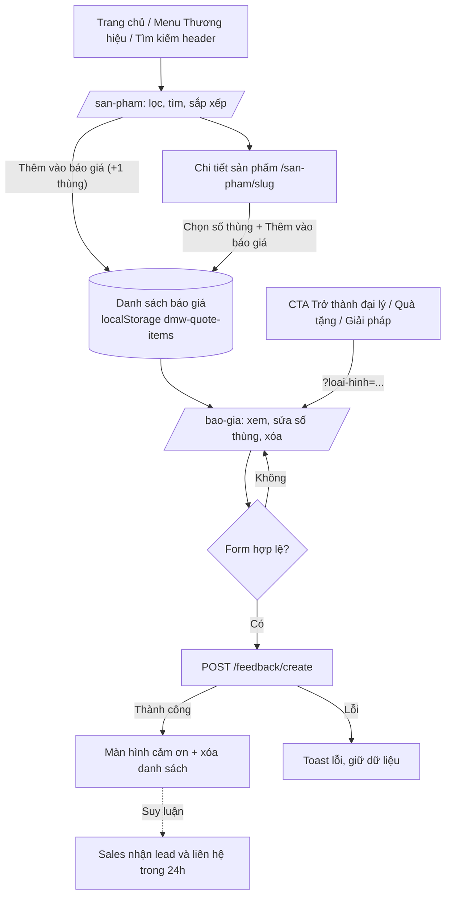
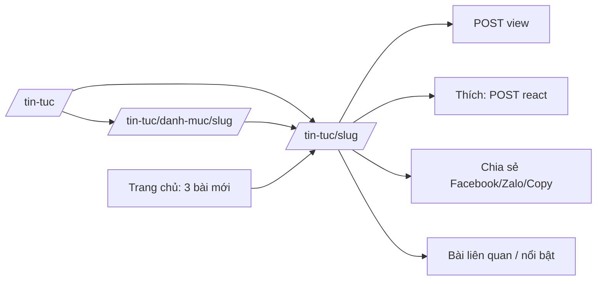

# ĐẶC TẢ CHỨC NĂNG – WEBSITE ĐỨC MINH WINE

| Mục | Nội dung |
|---|---|
| Phiên bản | 1.0 – bản phân tích từ source code |
| Ngày phân tích | 2026-10-28 |
| Source được phân tích | Repository `ducminh-wine`, nhánh `fix/refactor_code`, **bao gồm thay đổi chưa commit** trong working tree (nhiều trang của dự án cũ đã bị xóa, các trang sản phẩm/báo giá/giải pháp mới chưa được commit) |
| Tài liệu đi kèm | `FUNCTIONAL_CHECKLIST.xlsx` (checklist chức năng, màn hình, vấn đề cần xác nhận, test case UI) |

> **Quy ước mức độ tin cậy**
> - **Đã xác định**: có bằng chứng trực tiếp trong source code (file/dòng được dẫn chiếu).
> - **Suy luận**: chức năng dự kiến được suy ra từ giao diện/cấu trúc dữ liệu, cần chủ sản phẩm xác nhận.
> - **Chưa xác định**: không đủ thông tin để kết luận.
>
> Mọi kết luận về **Backend** đều là *“Chưa xác minh”* vì repository chỉ chứa Frontend.

## Mục lục
1. Tổng quan dự án và phạm vi phân tích
2. Cấu trúc hệ thống và phân chia Website/Admin
3. Danh sách module và màn hình
4. Đặc tả chi tiết từng chức năng
5. Luồng nghiệp vụ và luồng điều hướng dự kiến
6. Các trường dữ liệu trên form và bảng
7. Quy tắc validation
8. Trạng thái giao diện và phản hồi
9. Các chức năng/vấn đề cần xác nhận
10. Giả định, giới hạn và vấn đề chưa thể kết luận

## 1. Tổng quan dự án và phạm vi phân tích

**Đức Minh Wine** là website giới thiệu và thu hút khách hàng doanh nghiệp (B2B) của một nhà phân phối rượu tại Khánh Hòa. Website **không bán hàng trực tuyến, không hiển thị giá và không có tài khoản người dùng**; mô hình chuyển đổi chính là:

1. Khách duyệt danh mục sản phẩm → thêm sản phẩm (theo **thùng**) vào **danh sách báo giá** lưu trên trình duyệt;
2. Khách gửi **form yêu cầu báo giá/liên hệ** kèm danh sách đó → bộ phận kinh doanh liên hệ lại trong 24 giờ;
3. Các kênh liên hệ trực tiếp: hotline, Zalo, Facebook, email.

Website còn có **Tạp chí** (tin tức/bài viết) lấy dữ liệu từ API, và các trang nội dung: Giải pháp B2B, Về chúng tôi, Liên hệ.

**Phạm vi đã khảo sát:** toàn bộ `src/` (app routes, components, contexts, services, data, types, config, providers, axios), `next.config.ts`, `.env.example`, `public/`, và lịch sử git (để tìm khu vực Admin).

**Kết quả tổng hợp:**

- 10 module, 76 chức năng (68 Website, 8 Admin suy luận), 14 màn hình/khu vực, 33 vấn đề cần xác nhận, 56 test case UI.
- **Không có khu vực Admin** trong repository (kể cả trong lịch sử git). Các chức năng Admin trong tài liệu (`ADM-*`) là **suy luận** từ dữ liệu mà Website cần, không phải từ giao diện.
- **Không có đăng ký / đăng nhập / quên mật khẩu / hồ sơ người dùng** trên Website. Có service `user` (login/register/me) nhưng là mã tồn dư không được sử dụng (xem §10).
- Dữ liệu **sản phẩm, thương hiệu, loại, giải pháp, banner, thông tin liên hệ** đang **hardcode/dữ liệu mẫu** trong source. Chỉ **Tạp chí** và **form lead** thực sự gọi API.

## 2. Cấu trúc hệ thống và phân chia Website/Admin

### 2.1. Công nghệ

| Hạng mục | Công nghệ | Ghi chú |
|---|---|---|
| Framework | Next.js 15.2 (App Router), React 19, TypeScript | `distDir: build`, ISR (`revalidate`) cho trang chủ, tạp chí |
| Giao diện | Tailwind CSS 4, shadcn/ui (Radix: Tabs, Sheet, Select, Dialog…), lucide-react | `src/components/ui/*` |
| Form | react-hook-form + zod (`@hookform/resolvers`) | Chỉ dùng ở `QuoteForm`. Formik/Yup có trong package nhưng không dùng |
| State | React Context (`QuoteContext`) + localStorage | Redux store (`cartSlice`) được cấu hình nhưng không dùng; React Query được bọc nhưng không có query nào |
| HTTP | Axios wrapper `src/axios` (baseURL = `NEXT_PUBLIC_API_URL`, timeout 60s) | Tự hiện toast lỗi phía trình duyệt |
| Thông báo | react-toastify |  |
| Phân tích | Google Analytics (gtag) qua biến `NEXT_PUBLIC_GOOGLE_ANALYTICS` |  |
| Bảng/biểu đồ | Không có thư viện bảng dữ liệu hay biểu đồ | Không có dashboard |

### 2.2. Cấu trúc thư mục

| Thư mục | Vai trò |
|---|---|
| `src/app` | Route (App Router): trang chủ, products, quote, solutions, about, contact, news, not-found, sitemap, robots |
| `src/components/Home` | Các khối trang chủ (banner, danh mục, tab sản phẩm, thương hiệu, đại lý, quy trình, tạp chí) |
| `src/components/Products, Quote, News, site` | Danh mục sản phẩm, trang báo giá, tạp chí; thành phần dùng chung (ProductCard, QuoteForm, CtaBand…) |
| `src/components/Header.tsx, Footer.tsx` | Khung điều hướng chung |
| `src/contexts/QuoteContext.tsx` | Trạng thái danh sách báo giá |
| `src/services/news, feedback` | Gọi API thật (bài viết, lead) |
| `src/services/wine + src/data/*` | Lớp truy cập sản phẩm dựa trên dữ liệu mẫu (giữ chữ ký async để thay bằng API) |
| `src/config/site.ts` | Thông tin doanh nghiệp, liên hệ, menu, link CTA |
| `src/services/{book-visit, graves-search, media, offerings, payment, product, service-order, user}` | **Mã tồn dư** từ dự án trước, không được trang nào import |

### 2.3. Phân chia Website / Admin

| Khu vực | Có trong source? | Mô tả |
|---|---|---|
| Website (người dùng) | Có | Toàn bộ route trong `src/app`, layout chung trong `src/providers/ClientProvider.tsx` |
| Admin | **Không** | Không có route, layout, component, menu hay form quản trị. `src/middleware.ts` rỗng (`matcher: []`). Chỉ có kiểu `IAdmin` và `next-auth.d.ts` tồn dư |

### 2.4. Bảng route

URL công khai là URL tiếng Việt; Next.js rewrite sang route tiếng Anh (`next.config.ts:12-25`). URL tiếng Anh vẫn truy cập được.

| URL công khai | Route nội bộ | File | Render | Màn hình |
|---|---|---|---|---|
| / | / | src/app/page.tsx | ISR 60s | Trang chủ |
| /san-pham | /products | src/app/products/page.tsx | Động (searchParams) | Danh mục sản phẩm |
| /san-pham/[slug] | /products/[slug] | src/app/products/[slug]/page.tsx | SSG, dynamicParams=false | Chi tiết sản phẩm |
| /bao-gia | /quote | src/app/quote/page.tsx | Động | Yêu cầu báo giá |
| /giai-phap | /solutions | src/app/solutions/page.tsx | Tĩnh | Giải pháp B2B |
| /gioi-thieu | /about | src/app/about/page.tsx | Tĩnh | Về chúng tôi |
| /lien-he | /contact | src/app/contact/page.tsx | Tĩnh | Liên hệ |
| /tin-tuc | /news | src/app/news/page.tsx | ISR 60s | Tạp chí |
| /tin-tuc/danh-muc/[category] | /news/category/[category] | src/app/news/category/[category]/page.tsx | ISR 300s | Chủ đề Tạp chí |
| /tin-tuc/[slug] | /news/[slug] | src/app/news/[slug]/page.tsx | ISR 300s, dynamicParams=true | Chi tiết bài viết |
| /sitemap.xml, /robots.txt | — | src/app/sitemap.ts, robots.txt | — | SEO |
| (mọi URL sai) | — | src/app/not-found.tsx | — | 404 |

### 2.5. API mà Frontend đang gọi

| Method | Endpoint | Dùng ở | Service |
|---|---|---|---|
| GET | /client/categories | Tạp chí, chủ đề, sitemap | getListCategories |
| GET | /client/posts?category&amp;page&amp;per_page&amp;search&amp;isFeatured | Trang chủ (3 bài), phân trang chủ đề, bài nổi bật, sitemap (per_page=1000) | getListPosts |
| GET | /client/posts/homepage?limit | Trang Tạp chí (hero, featured, latest) | getListPostHomepage |
| GET | /client/posts/slug/{slug} | Chi tiết bài viết | getPostDetail |
| GET | /client/posts/related?postId&amp;limit | Bài liên quan | getRelatedPostsByCategory |
| GET | /client/posts/category/{slug} | Trang chủ đề (lần tải đầu) | getPostsByCategorySlug |
| POST | /client/posts/{id}/view | Đếm lượt xem | postView |
| GET | /client/posts/{id}/total-like | Lượt thích | getPostLikeStatus |
| POST | /client/posts/react {postId, reaction} | Thích/bỏ thích | reactToPost |
| POST | /feedback/create {name, phone, email?, subject, content} | Mọi form báo giá/liên hệ | createFeedback |

Base URL lấy từ `NEXT_PUBLIC_API_URL` (`.env.example` đang là `https://dummyjson.com`, không phải backend thật). Không có endpoint sản phẩm nào được gọi.

## 3. Danh sách module và màn hình

### 3.1. Module

| Module | Khu vực | Số chức năng | Mã chức năng |
|---|---|---|---|
| Khung giao diện chung | Website | 12 | GL-01 – GL-12 |
| Trang chủ | Website | 10 | TC-01 – TC-10 |
| Sản phẩm | Website | 17 | SP-01 – SP-17 |
| Danh sách & Yêu cầu báo giá | Website | 7 | BG-01 – BG-07 |
| Liên hệ | Website | 2 | LH-01 – LH-02 |
| Giải pháp B2B | Website | 4 | GP-01 – GP-04 |
| Giới thiệu | Website | 1 | GT-01 – GT-01 |
| Tạp chí / Tin tức | Website | 10 | TT-01 – TT-10 |
| SEO & Phân tích | Website | 5 | SEO-01 – SEO-05 |
| Quản trị (suy luận – không có UI) | Admin | 8 | ADM-01 – ADM-08 |

### 3.2. Màn hình

| # | Khu vực | Màn hình | Route | Module | Chức năng chính |
|---|---|---|---|---|---|
| 1 | Website | Trang chủ | `/` | Trang chủ | TC-01..TC-10, BG-05 |
| 2 | Website | Danh mục sản phẩm | `/san-pham (/products)` | Sản phẩm | SP-01..SP-12, GL-02 |
| 3 | Website | Chi tiết sản phẩm | `/san-pham/[slug] (/products/[slug])` | Sản phẩm | SP-13..SP-17, BG-01 |
| 4 | Website | Yêu cầu báo giá | `/bao-gia (/quote) [?loai-hinh=]` | Danh sách &amp; Yêu cầu báo giá | BG-02..BG-07 |
| 5 | Website | Giải pháp B2B | `/giai-phap (/solutions)` | Giải pháp B2B | GP-01..GP-04, TC-09 |
| 6 | Website | Về chúng tôi | `/gioi-thieu (/about)` | Giới thiệu | GT-01 |
| 7 | Website | Liên hệ | `/lien-he (/contact)` | Liên hệ | LH-01, LH-02 |
| 8 | Website | Tạp chí | `/tin-tuc (/news)` | Tạp chí / Tin tức | TT-01..TT-03 |
| 9 | Website | Chủ đề Tạp chí | `/tin-tuc/danh-muc/[category] (/news/category/[category])` | Tạp chí / Tin tức | TT-04, TT-05 |
| 10 | Website | Chi tiết bài viết | `/tin-tuc/[slug] (/news/[slug])` | Tạp chí / Tin tức | TT-06..TT-10 |
| 11 | Website | Trang 404 | `(mọi URL không tồn tại)` | Khung giao diện chung | GL-10 |
| 12 | Website | Header / Footer / thành phần chung | `(layout – mọi trang)` | Khung giao diện chung | GL-01..GL-12 |
| 13 | Website | Sitemap &amp; robots | `/sitemap.xml, /robots.txt` | SEO &amp; Phân tích | SEO-02 |
| 14 | Admin | Khu vực quản trị | `Không có trong source` | Quản trị (suy luận – không có UI) | ADM-01..ADM-08 |

## 4. Đặc tả chi tiết từng chức năng

Mỗi chức năng được mô tả theo cấu trúc thống nhất. Cột “Mức độ hoàn thiện” tổng hợp 4 trạng thái: UI / Logic Frontend / API / Backend.

### 4.1. Module: Khung giao diện chung

#### GL-01 – Thanh trên cùng (top bar) và hàng header chính

| Thuộc tính | Nội dung |
|---|---|
| **Mã chức năng** | GL-01 |
| **Tên chức năng** | Thanh trên cùng (top bar) và hàng header chính |
| **Module** | Khung giao diện chung |
| **Khu vực** | Website |
| **Màn hình/route** | Mọi trang (layout) |
| **Mục đích** | Hiển thị khẩu hiệu B2B, liên kết nhanh và logo/hotline trên mọi trang. |
| **Mô tả hoạt động** | Top bar (desktop ≥ md) gồm khẩu hiệu, link “Trở thành đại lý”, “Liên hệ kinh doanh”, email. Hàng header chính gồm nút mở menu (mobile), logo, ô tìm kiếm, hotline (≥ xl), biểu tượng danh sách báo giá, nút “Yêu cầu báo giá”. Header dính (sticky) trên mobile. |
| **Thành phần UI** | Top bar, Logo, SearchForm, link hotline (tel:), QuoteLink, Button “Yêu cầu báo giá” |
| **Dữ liệu đầu vào** | Không có (chỉ click). |
| **Kết quả mong đợi** | Điều hướng tới /bao-gia, /lien-he, mở ứng dụng email/điện thoại. |
| **Luồng xử lý dự kiến** | 1. Người dùng click liên kết 2. Trình duyệt điều hướng hoặc mở tel:/mailto: |
| **Quy tắc nghiệp vụ đã biết** | Nội dung lấy từ siteConfig (src/config/site.ts); các CTA dùng ctaLinks. |
| **Quy tắc validation** | Không áp dụng. |
| **Trạng thái & ngoại lệ** | Không có trạng thái loading/lỗi. |
| **Mức độ hoàn thiện** | Đã có UI (nội dung trình bày tĩnh) UI: Đã có · Logic FE: Không áp dụng · API: Dữ liệu tĩnh (hardcode) · Backend: Không áp dụng |
| **Độ tin cậy phân tích** | Đã xác định |
| **Mức độ ưu tiên** | Cao |
| **Căn cứ source code** | `src/components/Header.tsx:67-131` `src/config/site.ts:5-50` |
| **Giả định / ghi chú** | siteConfig có ghi chú TODO(business): cần thay thông tin liên hệ thật. |
| **Câu hỏi cần xác nhận** | Xem Q-05 (số điện thoại hiển thị khác số trong liên kết tel:/Zalo). |

#### GL-02 – Tìm kiếm sản phẩm toàn site

| Thuộc tính | Nội dung |
|---|---|
| **Mã chức năng** | GL-02 |
| **Tên chức năng** | Tìm kiếm sản phẩm toàn site |
| **Module** | Khung giao diện chung |
| **Khu vực** | Website |
| **Màn hình/route** | Header (mọi trang) → /san-pham?q= |
| **Mục đích** | Cho phép tìm sản phẩm từ bất kỳ trang nào. |
| **Mô tả hoạt động** | Form GET (next/form) gửi tham số q tới /san-pham. Trang danh mục đọc q làm giá trị tìm kiếm ban đầu và lọc client-side theo tên, nhà sản xuất, tên thương hiệu, vùng, quốc gia, giống nho (không phân biệt hoa thường). |
| **Thành phần UI** | Input type=search #site-search (placeholder “Tìm theo tên sản phẩm, thương hiệu…”), nút kính lúp |
| **Dữ liệu đầu vào** | q: chuỗi tự do. |
| **Kết quả mong đợi** | Trang /san-pham hiển thị kết quả lọc và chip ““q””. |
| **Luồng xử lý dự kiến** | 1. Nhập từ khóa 2. Nhấn Enter/nút tìm 3. Điều hướng /san-pham?q=... 4. CatalogClient khởi tạo search = q và lọc |
| **Quy tắc nghiệp vụ đã biết** | Tìm kiếm khớp chuỗi con (includes) sau khi trim + lowercase; không bỏ dấu tiếng Việt. |
| **Quy tắc validation** | Không có ràng buộc độ dài; chuỗi rỗng → hiển thị tất cả. |
| **Trạng thái & ngoại lệ** | Không có kết quả → trạng thái rỗng của danh mục (SP-11). |
| **Mức độ hoàn thiện** | Đã có UI & logic – dùng dữ liệu mẫu, chưa có API UI: Đã có · Logic FE: Đã có · API: Dữ liệu mẫu (mock) · Backend: Chưa xác minh (không có source) |
| **Độ tin cậy phân tích** | Đã xác định |
| **Mức độ ưu tiên** | Cao |
| **Căn cứ source code** | `src/components/Header.tsx:307-329` `src/app/products/page.tsx:19-38` `src/services/wine/index.ts:33-44` |
| **Giả định / ghi chú** | Tìm kiếm chỉ trên dữ liệu mẫu trong bộ nhớ; không tìm bài viết. |
| **Câu hỏi cần xác nhận** | Q-21: có cần tìm cả bài viết? Có cần tìm không dấu? |

#### GL-03 – Mega menu “Thương hiệu” (desktop)

| Thuộc tính | Nội dung |
|---|---|
| **Mã chức năng** | GL-03 |
| **Tên chức năng** | Mega menu “Thương hiệu” (desktop) |
| **Module** | Khung giao diện chung |
| **Khu vực** | Website |
| **Màn hình/route** | Mọi trang (≥ lg) |
| **Mục đích** | Điều hướng nhanh tới sản phẩm theo thương hiệu và khối quà tặng doanh nghiệp. |
| **Mô tả hoạt động** | Hover/click nút “Thương hiệu” mở mega menu gồm các cột thương hiệu (logo + tên) → /san-pham?thuong-hieu=&lt;slug&gt;, link “Xem tất cả sản phẩm” và thẻ “Quà tặng doanh nghiệp” → /bao-gia?loai-hinh=Quà tặng doanh nghiệp. Đóng khi rời chuột, nhấn Esc hoặc đổi trang. |
| **Thành phần UI** | Nút LayoutGrid “Thương hiệu”, #mega-menu, BrandMark (ảnh logo, fallback chữ cái đầu) |
| **Dữ liệu đầu vào** | Không. |
| **Kết quả mong đợi** | Điều hướng tới danh mục đã lọc theo thương hiệu. |
| **Luồng xử lý dự kiến** | 1. Hover nút 2. Menu hiện 3. Click thương hiệu 4. Điều hướng /san-pham?thuong-hieu=slug |
| **Quy tắc nghiệp vụ đã biết** | Danh sách thương hiệu lấy từ src/data/brands.ts; logo /images/brands/&lt;slug&gt;.png. |
| **Quy tắc validation** | Không áp dụng. |
| **Trạng thái & ngoại lệ** | Ảnh logo lỗi → hiển thị chữ cái đầu tên thương hiệu. |
| **Mức độ hoàn thiện** | Đã có UI & logic – có lỗi cần sửa UI: Đã có · Logic FE: Đã có · API: Dữ liệu tĩnh (hardcode) · Backend: Chưa xác minh (không có source) |
| **Độ tin cậy phân tích** | Đã xác định |
| **Mức độ ưu tiên** | Cao |
| **Căn cứ source code** | `src/components/Header.tsx:133-216, 384-399` `src/data/brands.ts` |
| **Giả định / ghi chú** | Thư mục public/images/brands đang trống → mọi logo đều rơi vào fallback. Không sản phẩm nào có trường brand → mọi link thương hiệu dẫn tới danh mục rỗng. |
| **Câu hỏi cần xác nhận** | Q-04 |

#### GL-04 – Thanh điều hướng chính & trạng thái active

| Thuộc tính | Nội dung |
|---|---|
| **Mã chức năng** | GL-04 |
| **Tên chức năng** | Thanh điều hướng chính &amp; trạng thái active |
| **Module** | Khung giao diện chung |
| **Khu vực** | Website |
| **Màn hình/route** | Mọi trang (≥ lg) |
| **Mục đích** | Điều hướng giữa các trang chính. |
| **Mô tả hoạt động** | Thanh nav dính (sticky) gồm: Thương hiệu (mega), Sản phẩm, Quà tặng doanh nghiệp (/giai-phap#qua-tang), Về chúng tôi, Tin tức, Liên hệ, và “Trở thành đại lý” bên phải. Mục đang mở được gạch chân vàng (aria-current=page). |
| **Thành phần UI** | NavLink, mainNav |
| **Dữ liệu đầu vào** | Không. |
| **Kết quả mong đợi** | Điều hướng. |
| **Luồng xử lý dự kiến** | 1. Click mục menu 2. Điều hướng; mục active được tô |
| **Quy tắc nghiệp vụ đã biết** | Mục có '#' không bao giờ active; 'Sản phẩm' active khi path bắt đầu /san-pham hoặc /products. |
| **Quy tắc validation** | Không áp dụng. |
| **Trạng thái & ngoại lệ** | Không. |
| **Mức độ hoàn thiện** | Đã có UI (nội dung trình bày tĩnh) UI: Đã có · Logic FE: Không áp dụng · API: Dữ liệu tĩnh (hardcode) · Backend: Không áp dụng |
| **Độ tin cậy phân tích** | Đã xác định |
| **Mức độ ưu tiên** | Cao |
| **Căn cứ source code** | `src/components/Header.tsx:59-63, 133-177, 331-345` `src/config/site.ts:43-49` |
| **Giả định / ghi chú** | Mục “Giải pháp B2B” trong mainNav đang bị comment. |
| **Câu hỏi cần xác nhận** | Q-17 |

#### GL-05 – Menu ngăn kéo trên mobile (drawer)

| Thuộc tính | Nội dung |
|---|---|
| **Mã chức năng** | GL-05 |
| **Tên chức năng** | Menu ngăn kéo trên mobile (drawer) |
| **Module** | Khung giao diện chung |
| **Khu vực** | Website |
| **Màn hình/route** | Mọi trang (&lt; lg) |
| **Mục đích** | Điều hướng trên thiết bị di động. |
| **Mô tả hoạt động** | Nút ☰ mở drawer bên trái (role=dialog, aria-modal). Gồm Trang chủ, nhóm “Thương hiệu” dạng accordion (chip thương hiệu), các mục mainNav, nút Yêu cầu báo giá / Trở thành đại lý / Liên hệ kinh doanh, hotline. Đóng bằng nút X, click nền mờ, phím Esc hoặc khi đổi trang; khóa cuộn body khi mở; focus vào link đầu tiên. |
| **Thành phần UI** | #mobile-drawer, overlay, details/summary, DrawerChips |
| **Dữ liệu đầu vào** | Không. |
| **Kết quả mong đợi** | Điều hướng. |
| **Luồng xử lý dự kiến** | 1. Nhấn ☰ hoặc “Danh mục” ở action bar 2. Drawer mở, body khóa cuộn 3. Chọn mục → điều hướng &amp; đóng |
| **Quy tắc nghiệp vụ đã biết** | Accordion Thương hiệu mở sẵn khi đang ở trang sản phẩm. |
| **Quy tắc validation** | Không áp dụng. |
| **Trạng thái & ngoại lệ** | Mở/đóng có hiệu ứng. |
| **Mức độ hoàn thiện** | Đã có UI (nội dung trình bày tĩnh) UI: Đã có · Logic FE: Không áp dụng · API: Dữ liệu tĩnh (hardcode) · Backend: Không áp dụng |
| **Độ tin cậy phân tích** | Đã xác định |
| **Mức độ ưu tiên** | Cao |
| **Căn cứ source code** | `src/components/Header.tsx:34-57, 218-299` |
| **Giả định / ghi chú** | — |
| **Câu hỏi cần xác nhận** | — |

#### GL-06 – Thanh hành động cố định đáy màn hình (mobile)

| Thuộc tính | Nội dung |
|---|---|
| **Mã chức năng** | GL-06 |
| **Tên chức năng** | Thanh hành động cố định đáy màn hình (mobile) |
| **Module** | Khung giao diện chung |
| **Khu vực** | Website |
| **Màn hình/route** | Mọi trang (&lt; lg) |
| **Mục đích** | Truy cập nhanh các hành động chuyển đổi trên mobile. |
| **Mô tả hoạt động** | 4 nút cố định đáy: Danh mục (mở drawer), Gọi ngay (tel:), Zalo (tab mới), Báo giá (/bao-gia, có badge số sản phẩm trong danh sách). |
| **Thành phần UI** | MobileActionBar |
| **Dữ liệu đầu vào** | Không. |
| **Kết quả mong đợi** | Mở drawer / gọi điện / mở Zalo / điều hướng báo giá. |
| **Luồng xử lý dự kiến** | 1. Nhấn nút 2. Thực hiện hành động tương ứng |
| **Quy tắc nghiệp vụ đã biết** | Badge chỉ hiển thị sau khi đã đọc localStorage (hydrated) và count &gt; 0. |
| **Quy tắc validation** | Không áp dụng. |
| **Trạng thái & ngoại lệ** | Không. |
| **Mức độ hoàn thiện** | Đã có UI (nội dung trình bày tĩnh) UI: Đã có · Logic FE: Không áp dụng · API: Dữ liệu tĩnh (hardcode) · Backend: Không áp dụng |
| **Độ tin cậy phân tích** | Đã xác định |
| **Mức độ ưu tiên** | Trung bình |
| **Căn cứ source code** | `src/components/Header.tsx:445-476` |
| **Giả định / ghi chú** | — |
| **Câu hỏi cần xác nhận** | — |

#### GL-07 – Thanh liên hệ nổi bên phải (desktop)

| Thuộc tính | Nội dung |
|---|---|
| **Mã chức năng** | GL-07 |
| **Tên chức năng** | Thanh liên hệ nổi bên phải (desktop) |
| **Module** | Khung giao diện chung |
| **Khu vực** | Website |
| **Màn hình/route** | Mọi trang (≥ lg) |
| **Mục đích** | Giữ kênh liên hệ luôn hiển thị. |
| **Mô tả hoạt động** | Cột 3 nút giữa mép phải: Gọi, Chat Zalo, Fanpage Facebook; tooltip khi hover/focus. |
| **Thành phần UI** | FloatingContact |
| **Dữ liệu đầu vào** | Không. |
| **Kết quả mong đợi** | Mở tel:/Zalo/Facebook. |
| **Luồng xử lý dự kiến** | 1. Hover → tooltip 2. Click → mở kênh liên hệ |
| **Quy tắc nghiệp vụ đã biết** | Link lấy từ siteConfig.contact. |
| **Quy tắc validation** | Không áp dụng. |
| **Trạng thái & ngoại lệ** | Không. |
| **Mức độ hoàn thiện** | Đã có UI (nội dung trình bày tĩnh) UI: Đã có · Logic FE: Không áp dụng · API: Dữ liệu tĩnh (hardcode) · Backend: Không áp dụng |
| **Độ tin cậy phân tích** | Đã xác định |
| **Mức độ ưu tiên** | Thấp |
| **Căn cứ source code** | `src/components/Header.tsx:486-530` |
| **Giả định / ghi chú** | — |
| **Câu hỏi cần xác nhận** | — |

#### GL-08 – Biểu tượng & bộ đếm danh sách báo giá ở header

| Thuộc tính | Nội dung |
|---|---|
| **Mã chức năng** | GL-08 |
| **Tên chức năng** | Biểu tượng &amp; bộ đếm danh sách báo giá ở header |
| **Module** | Khung giao diện chung |
| **Khu vực** | Website |
| **Màn hình/route** | Mọi trang |
| **Mục đích** | Cho biết số sản phẩm đang có trong danh sách báo giá. |
| **Mô tả hoạt động** | Icon FileText kèm badge số dòng (count = số sản phẩm khác nhau, không phải số thùng). Click → /bao-gia. |
| **Thành phần UI** | QuoteLink |
| **Dữ liệu đầu vào** | Dữ liệu từ QuoteContext. |
| **Kết quả mong đợi** | Hiển thị số lượng; điều hướng /bao-gia. |
| **Luồng xử lý dự kiến** | 1. Đọc QuoteContext 2. Hiển thị badge nếu count &gt; 0 |
| **Quy tắc nghiệp vụ đã biết** | count = items.length; badge ẩn trước khi hydrate để tránh lệch SSR. |
| **Quy tắc validation** | Không áp dụng. |
| **Trạng thái & ngoại lệ** | Chưa hydrate → không có badge. |
| **Mức độ hoàn thiện** | Đã có UI & logic phía client UI: Đã có · Logic FE: Đã có · API: Không áp dụng · Backend: Không áp dụng |
| **Độ tin cậy phân tích** | Đã xác định |
| **Mức độ ưu tiên** | Trung bình |
| **Căn cứ source code** | `src/components/Header.tsx:418-443` `src/contexts/QuoteContext.tsx:71-83` |
| **Giả định / ghi chú** | Sản phẩm có slug không còn trong dữ liệu vẫn được đếm nhưng không hiển thị ở trang báo giá. |
| **Câu hỏi cần xác nhận** | Q-09 |

#### GL-09 – Footer

| Thuộc tính | Nội dung |
|---|---|
| **Mã chức năng** | GL-09 |
| **Tên chức năng** | Footer |
| **Module** | Khung giao diện chung |
| **Khu vực** | Website |
| **Màn hình/route** | Mọi trang |
| **Mục đích** | Cung cấp CTA, thông tin liên hệ và liên kết SEO nội bộ. |
| **Mô tả hoạt động** | Dải CTA vàng (Yêu cầu báo giá / Trở thành đại lý / Liên hệ kinh doanh); khối thương hiệu + mô tả + địa chỉ, hotline, Zalo, email, giờ làm việc; 3 cột link (Sản phẩm theo loại, Giải pháp B2B theo anchor, Hỗ trợ khách hàng); dải tag “Rượu vang &lt;quốc gia&gt;” và “Vang &lt;nhu cầu&gt;” → /san-pham?quoc-gia= / ?nhu-cau=; bản quyền và cảnh báo uống có trách nhiệm. |
| **Thành phần UI** | Footer, Button, Logo |
| **Dữ liệu đầu vào** | Không. |
| **Kết quả mong đợi** | Điều hướng. |
| **Luồng xử lý dự kiến** | 1. Click link → điều hướng tới danh mục đã lọc hoặc trang tương ứng |
| **Quy tắc nghiệp vụ đã biết** | Danh sách quốc gia tính động từ dữ liệu sản phẩm mẫu. |
| **Quy tắc validation** | Không áp dụng. |
| **Trạng thái & ngoại lệ** | Không. |
| **Mức độ hoàn thiện** | Đã có UI (nội dung trình bày tĩnh) UI: Đã có · Logic FE: Không áp dụng · API: Dữ liệu tĩnh (hardcode) · Backend: Không áp dụng |
| **Độ tin cậy phân tích** | Đã xác định |
| **Mức độ ưu tiên** | Trung bình |
| **Căn cứ source code** | `src/components/Footer.tsx` |
| **Giả định / ghi chú** | — |
| **Câu hỏi cần xác nhận** | — |

#### GL-10 – Trang 404

| Thuộc tính | Nội dung |
|---|---|
| **Mã chức năng** | GL-10 |
| **Tên chức năng** | Trang 404 |
| **Module** | Khung giao diện chung |
| **Khu vực** | Website |
| **Màn hình/route** | Bất kỳ đường dẫn không tồn tại; sản phẩm/bài viết không tìm thấy |
| **Mục đích** | Thông báo không tìm thấy trang và hướng người dùng quay lại. |
| **Mô tả hoạt động** | Hiển thị “404”, thông điệp và 2 nút: Xem sản phẩm (/san-pham), Về trang chủ (/). |
| **Thành phần UI** | NotFound, Button |
| **Dữ liệu đầu vào** | Không. |
| **Kết quả mong đợi** | Điều hướng. |
| **Luồng xử lý dự kiến** | 1. Truy cập URL sai → hiển thị 404 |
| **Quy tắc nghiệp vụ đã biết** | Chi tiết sản phẩm dùng dynamicParams=false nên slug lạ trả 404; bài viết/chủ đề lỗi API cũng trả 404. |
| **Quy tắc validation** | Không áp dụng. |
| **Trạng thái & ngoại lệ** | Không. |
| **Mức độ hoàn thiện** | Đã có UI (nội dung trình bày tĩnh) UI: Đã có · Logic FE: Không áp dụng · API: Không áp dụng · Backend: Không áp dụng |
| **Độ tin cậy phân tích** | Đã xác định |
| **Mức độ ưu tiên** | Trung bình |
| **Căn cứ source code** | `src/app/not-found.tsx` |
| **Giả định / ghi chú** | — |
| **Câu hỏi cần xác nhận** | — |

#### GL-11 – Thông báo toast & xử lý lỗi API chung

| Thuộc tính | Nội dung |
|---|---|
| **Mã chức năng** | GL-11 |
| **Tên chức năng** | Thông báo toast &amp; xử lý lỗi API chung |
| **Module** | Khung giao diện chung |
| **Khu vực** | Website |
| **Màn hình/route** | Mọi trang |
| **Mục đích** | Phản hồi kết quả thao tác và lỗi gọi API. |
| **Mô tả hoạt động** | ToastContainer (top-right, 3s). Axios service tự hiện toast lỗi (message từ server hoặc “Có lỗi xảy ra”) cho mọi request lỗi phía trình duyệt; lỗi 401/403 có nhánh logout nhưng đang để trống. |
| **Thành phần UI** | ToastContainer (react-toastify) |
| **Dữ liệu đầu vào** | Lỗi từ API. |
| **Kết quả mong đợi** | Toast lỗi/thành công. |
| **Luồng xử lý dự kiến** | 1. Request lỗi 2. Interceptor hiển thị toast 3. Promise reject cho caller |
| **Quy tắc nghiệp vụ đã biết** | Toast lỗi tự động chỉ chạy ở trình duyệt (không ở SSR). |
| **Quy tắc validation** | Không áp dụng. |
| **Trạng thái & ngoại lệ** | Lỗi form báo giá có thể hiện 2 toast (một từ axios service, một từ QuoteForm). |
| **Mức độ hoàn thiện** | Đã có UI & logic phía client UI: Đã có · Logic FE: Đã có · API: Không áp dụng · Backend: Không áp dụng |
| **Độ tin cậy phân tích** | Đã xác định |
| **Mức độ ưu tiên** | Trung bình |
| **Căn cứ source code** | `src/providers/ClientProvider.tsx:26-37` `src/axios/service.ts:11-23, 102-119` |
| **Giả định / ghi chú** | Các lỗi nền (đếm lượt xem, lượt thích) cũng sẽ bật toast lỗi cho người đọc. |
| **Câu hỏi cần xác nhận** | Q-25: có muốn tắt toast tự động cho request chạy nền? |

#### GL-12 – Liên kết “Bỏ qua đến nội dung chính” (accessibility)

| Thuộc tính | Nội dung |
|---|---|
| **Mã chức năng** | GL-12 |
| **Tên chức năng** | Liên kết “Bỏ qua đến nội dung chính” (accessibility) |
| **Module** | Khung giao diện chung |
| **Khu vực** | Website |
| **Màn hình/route** | Mọi trang |
| **Mục đích** | Hỗ trợ người dùng bàn phím/trình đọc màn hình. |
| **Mô tả hoạt động** | Link ẩn, hiện khi focus, nhảy tới #main. |
| **Thành phần UI** | Skip link |
| **Dữ liệu đầu vào** | Phím Tab. |
| **Kết quả mong đợi** | Focus chuyển tới nội dung chính. |
| **Luồng xử lý dự kiến** | 1. Nhấn Tab khi vào trang 2. Link xuất hiện 3. Enter → nhảy tới #main |
| **Quy tắc nghiệp vụ đã biết** | Không. |
| **Quy tắc validation** | Không áp dụng. |
| **Trạng thái & ngoại lệ** | Không. |
| **Mức độ hoàn thiện** | Đã có UI (nội dung trình bày tĩnh) UI: Đã có · Logic FE: Không áp dụng · API: Không áp dụng · Backend: Không áp dụng |
| **Độ tin cậy phân tích** | Đã xác định |
| **Mức độ ưu tiên** | Thấp |
| **Căn cứ source code** | `src/providers/ClientProvider.tsx:17-24` |
| **Giả định / ghi chú** | — |
| **Câu hỏi cần xác nhận** | — |

### 4.2. Module: Trang chủ

#### TC-01 – Banner slider trang chủ

| Thuộc tính | Nội dung |
|---|---|
| **Mã chức năng** | TC-01 |
| **Tên chức năng** | Banner slider trang chủ |
| **Module** | Trang chủ |
| **Khu vực** | Website |
| **Màn hình/route** | / |
| **Mục đích** | Quảng bá sản phẩm/chương trình chính và dẫn tới CTA. |
| **Mô tả hoạt động** | 2 slide ảnh (D'Gold → /bao-gia; Rum Nha Trang → /bao-gia?loai-hinh=Nhà phân phối / Đại lý). Tự chuyển mỗi 5s, dừng khi hover/focus/chạm, vuốt &gt; 50px để chuyển, nút trước/sau, chấm chỉ mục; tôn trọng prefers-reduced-motion. Phần chữ trên banner đang bị comment (chỉ hiển thị ảnh). |
| **Thành phần UI** | BannerSlider, nút ChevronLeft/Right, dots |
| **Dữ liệu đầu vào** | Click/vuốt. |
| **Kết quả mong đợi** | Chuyển slide; điều hướng theo href slide. |
| **Luồng xử lý dự kiến** | 1. Trang tải → slide 1 2. Sau 5s → slide kế (vòng lặp) 3. Click slide → điều hướng |
| **Quy tắc nghiệp vụ đã biết** | INTERVAL = 5000ms, SWIPE_THRESHOLD = 50px; không tự chạy nếu &lt; 2 slide. |
| **Quy tắc validation** | Không áp dụng. |
| **Trạng thái & ngoại lệ** | Không. |
| **Mức độ hoàn thiện** | Đã có UI (nội dung trình bày tĩnh) UI: Đã có · Logic FE: Không áp dụng · API: Dữ liệu tĩnh (hardcode) · Backend: Không áp dụng |
| **Độ tin cậy phân tích** | Đã xác định |
| **Mức độ ưu tiên** | Trung bình |
| **Căn cứ source code** | `src/components/Home/BannerSlider.tsx` `src/components/Home/HomeHero.tsx:6-25` |
| **Giả định / ghi chú** | Nội dung banner hardcode trong code. |
| **Câu hỏi cần xác nhận** | Q-26: banner có cần quản trị được (ADM-06)? |

#### TC-02 – Dải cam kết (USP) dưới banner

| Thuộc tính | Nội dung |
|---|---|
| **Mã chức năng** | TC-02 |
| **Tên chức năng** | Dải cam kết (USP) dưới banner |
| **Module** | Trang chủ |
| **Khu vực** | Website |
| **Màn hình/route** | / |
| **Mục đích** | Truyền tải cam kết của doanh nghiệp. |
| **Mô tả hoạt động** | 4 ô tĩnh: Nhập khẩu chính ngạch, Hóa đơn VAT, Tư vấn sommelier, Mẫu thử cho đối tác. |
| **Thành phần UI** | HomeHero usps |
| **Dữ liệu đầu vào** | Không. |
| **Kết quả mong đợi** | Hiển thị. |
| **Luồng xử lý dự kiến** | 1. Hiển thị tĩnh |
| **Quy tắc nghiệp vụ đã biết** | Không. |
| **Quy tắc validation** | Không áp dụng. |
| **Trạng thái & ngoại lệ** | Không. |
| **Mức độ hoàn thiện** | Đã có UI (nội dung trình bày tĩnh) UI: Đã có · Logic FE: Không áp dụng · API: Dữ liệu tĩnh (hardcode) · Backend: Không áp dụng |
| **Độ tin cậy phân tích** | Đã xác định |
| **Mức độ ưu tiên** | Thấp |
| **Căn cứ source code** | `src/components/Home/HomeHero.tsx:27-55` |
| **Giả định / ghi chú** | — |
| **Câu hỏi cần xác nhận** | — |

#### TC-03 – Ô danh mục theo loại sản phẩm

| Thuộc tính | Nội dung |
|---|---|
| **Mã chức năng** | TC-03 |
| **Tên chức năng** | Ô danh mục theo loại sản phẩm |
| **Module** | Trang chủ |
| **Khu vực** | Website |
| **Màn hình/route** | / |
| **Mục đích** | Điều hướng nhanh tới danh mục theo loại. |
| **Mô tả hoạt động** | Mỗi loại (wineTypes) một ô có hình chai mẫu, tên loại và số sản phẩm → /san-pham?loai=&lt;type&gt;; thêm ô “Quà tặng doanh nghiệp” (→ /bao-gia?loai-hinh=…) và “Tất cả” (tổng số sản phẩm). |
| **Thành phần UI** | HomeCategories, WineBottle |
| **Dữ liệu đầu vào** | Không. |
| **Kết quả mong đợi** | Điều hướng danh mục đã lọc. |
| **Luồng xử lý dự kiến** | 1. Click ô → /san-pham?loai=... |
| **Quy tắc nghiệp vụ đã biết** | Số lượng đếm từ dữ liệu mẫu. |
| **Quy tắc validation** | Không áp dụng. |
| **Trạng thái & ngoại lệ** | Loại không có sản phẩm vẫn hiển thị với 0 sản phẩm. |
| **Mức độ hoàn thiện** | Đã có UI & logic – dùng dữ liệu mẫu, chưa có API UI: Đã có · Logic FE: Đã có · API: Dữ liệu mẫu (mock) · Backend: Chưa xác minh (không có source) |
| **Độ tin cậy phân tích** | Đã xác định |
| **Mức độ ưu tiên** | Trung bình |
| **Căn cứ source code** | `src/components/Home/HomeSections.tsx:26-84` `src/data/wines.ts (wineTypes)` |
| **Giả định / ghi chú** | Nhãn loại đang là tên dòng sản phẩm (RUM NHA TRANG, RUM DGOLD VINA, ASIA, Hàn Việt, ISC) trong khi giá trị là red/white/rose/sparkling/sweet. |
| **Câu hỏi cần xác nhận** | Q-03 |

#### TC-04 – Sản phẩm xu hướng theo tab

| Thuộc tính | Nội dung |
|---|---|
| **Mã chức năng** | TC-04 |
| **Tên chức năng** | Sản phẩm xu hướng theo tab |
| **Module** | Trang chủ |
| **Khu vực** | Website |
| **Màn hình/route** | / |
| **Mục đích** | Giới thiệu sản phẩm nổi bật theo loại. |
| **Mô tả hoạt động** | Tab “Tất cả” + mỗi loại có sản phẩm; tab rỗng bị ẩn. Hiển thị tối đa 10 thẻ sản phẩm; sản phẩm có badge được ưu tiên ở tab Tất cả. Nút “Xem tất cả[: loại]” → danh mục đã lọc. |
| **Thành phần UI** | ProductTabs (role=tablist), ProductCard |
| **Dữ liệu đầu vào** | Chọn tab. |
| **Kết quả mong đợi** | Lưới sản phẩm của tab. |
| **Luồng xử lý dự kiến** | 1. Mặc định tab đầu 2. Click tab → đổi lưới 3. Click “Xem tất cả” → /san-pham?loai= |
| **Quy tắc nghiệp vụ đã biết** | limit = 10; sắp xếp featured: sản phẩm có badge lên trước. |
| **Quy tắc validation** | Không áp dụng. |
| **Trạng thái & ngoại lệ** | Không có tab nào có sản phẩm → ẩn cả khối. |
| **Mức độ hoàn thiện** | Đã có UI & logic – dùng dữ liệu mẫu, chưa có API UI: Đã có · Logic FE: Đã có · API: Dữ liệu mẫu (mock) · Backend: Chưa xác minh (không có source) |
| **Độ tin cậy phân tích** | Đã xác định |
| **Mức độ ưu tiên** | Cao |
| **Căn cứ source code** | `src/components/Home/ProductTabs.tsx` `src/app/page.tsx:30-48` |
| **Giả định / ghi chú** | — |
| **Câu hỏi cần xác nhận** | — |

#### TC-05 – Khối chương trình đại lý

| Thuộc tính | Nội dung |
|---|---|
| **Mã chức năng** | TC-05 |
| **Tên chức năng** | Khối chương trình đại lý |
| **Module** | Trang chủ |
| **Khu vực** | Website |
| **Màn hình/route** | / |
| **Mục đích** | Thu hút đối tác phân phối. |
| **Mô tả hoạt động** | Tiêu đề, mô tả và 4 quyền lợi từ giải pháp “phan-phoi”; nút “Trở thành đại lý” (→ /bao-gia?loai-hinh=Nhà phân phối / Đại lý) và “Liên hệ kinh doanh”. |
| **Thành phần UI** | HomeDealer |
| **Dữ liệu đầu vào** | Không. |
| **Kết quả mong đợi** | Điều hướng. |
| **Luồng xử lý dự kiến** | 1. Click CTA → trang báo giá đã chọn sẵn loại hình |
| **Quy tắc nghiệp vụ đã biết** | Không. |
| **Quy tắc validation** | Không áp dụng. |
| **Trạng thái & ngoại lệ** | Không. |
| **Mức độ hoàn thiện** | Đã có UI (nội dung trình bày tĩnh) UI: Đã có · Logic FE: Không áp dụng · API: Dữ liệu tĩnh (hardcode) · Backend: Không áp dụng |
| **Độ tin cậy phân tích** | Đã xác định |
| **Mức độ ưu tiên** | Trung bình |
| **Căn cứ source code** | `src/components/Home/HomeSections.tsx:193-240` `src/data/solutions.ts:47-62` |
| **Giả định / ghi chú** | — |
| **Câu hỏi cần xác nhận** | — |

#### TC-06 – Khối thương hiệu

| Thuộc tính | Nội dung |
|---|---|
| **Mã chức năng** | TC-06 |
| **Tên chức năng** | Khối thương hiệu |
| **Module** | Trang chủ |
| **Khu vực** | Website |
| **Màn hình/route** | / |
| **Mục đích** | Giới thiệu các thương hiệu phân phối. |
| **Mô tả hoạt động** | Lưới logo thương hiệu → /san-pham?thuong-hieu=&lt;slug&gt;; logo lỗi → hiển thị tên. |
| **Thành phần UI** | HomeBrands, BrandLogo |
| **Dữ liệu đầu vào** | Không. |
| **Kết quả mong đợi** | Điều hướng danh mục theo thương hiệu. |
| **Luồng xử lý dự kiến** | 1. Click logo → danh mục lọc thương hiệu |
| **Quy tắc nghiệp vụ đã biết** | Ẩn khối nếu không có thương hiệu. |
| **Quy tắc validation** | Không áp dụng. |
| **Trạng thái & ngoại lệ** | Logo lỗi → fallback tên. |
| **Mức độ hoàn thiện** | Đã có UI & logic – có lỗi cần sửa UI: Đã có · Logic FE: Đã có · API: Dữ liệu tĩnh (hardcode) · Backend: Chưa xác minh (không có source) |
| **Độ tin cậy phân tích** | Đã xác định |
| **Mức độ ưu tiên** | Trung bình |
| **Căn cứ source code** | `src/components/Home/HomeBrands.tsx` `src/data/brands.ts` |
| **Giả định / ghi chú** | Như GL-03: link luôn ra danh mục rỗng vì sản phẩm không có brand. |
| **Câu hỏi cần xác nhận** | Q-04 |

#### TC-07 – Khối quy trình hợp tác

| Thuộc tính | Nội dung |
|---|---|
| **Mã chức năng** | TC-07 |
| **Tên chức năng** | Khối quy trình hợp tác |
| **Module** | Trang chủ |
| **Khu vực** | Website |
| **Màn hình/route** | / |
| **Mục đích** | Mô tả 4 bước hợp tác. |
| **Mô tả hoạt động** | 4 bước tĩnh từ partnershipSteps. |
| **Thành phần UI** | HomeProcess |
| **Dữ liệu đầu vào** | Không. |
| **Kết quả mong đợi** | Hiển thị. |
| **Luồng xử lý dự kiến** | 1. Hiển thị tĩnh |
| **Quy tắc nghiệp vụ đã biết** | Không. |
| **Quy tắc validation** | Không áp dụng. |
| **Trạng thái & ngoại lệ** | Không. |
| **Mức độ hoàn thiện** | Đã có UI (nội dung trình bày tĩnh) UI: Đã có · Logic FE: Không áp dụng · API: Dữ liệu tĩnh (hardcode) · Backend: Không áp dụng |
| **Độ tin cậy phân tích** | Đã xác định |
| **Mức độ ưu tiên** | Thấp |
| **Căn cứ source code** | `src/components/Home/HomeSections.tsx:242-259` `src/data/solutions.ts:81-86` |
| **Giả định / ghi chú** | — |
| **Câu hỏi cần xác nhận** | — |

#### TC-08 – Khối Tạp chí trên trang chủ

| Thuộc tính | Nội dung |
|---|---|
| **Mã chức năng** | TC-08 |
| **Tên chức năng** | Khối Tạp chí trên trang chủ |
| **Module** | Trang chủ |
| **Khu vực** | Website |
| **Màn hình/route** | / |
| **Mục đích** | Hiển thị 3 bài viết mới nhất. |
| **Mô tả hoạt động** | Gọi getListPosts({per_page: 3}) phía server (ISR 60s); hiển thị 3 PostCard và link “Tất cả bài viết”. Lỗi API hoặc không có bài → ẩn khối. |
| **Thành phần UI** | HomeJournal, PostCard |
| **Dữ liệu đầu vào** | Không. |
| **Kết quả mong đợi** | 3 thẻ bài viết. |
| **Luồng xử lý dự kiến** | 1. Server gọi GET /client/posts?per_page=3 2. Render 3 bài 3. Click → /tin-tuc/&lt;slug&gt; |
| **Quy tắc nghiệp vụ đã biết** | Trang chủ revalidate = 60 giây. |
| **Quy tắc validation** | Không áp dụng. |
| **Trạng thái & ngoại lệ** | Rỗng/lỗi → ẩn khối. |
| **Mức độ hoàn thiện** | Đã có UI, logic và gọi API – chưa xác minh backend UI: Đã có · Logic FE: Đã có · API: Đã tích hợp · Backend: Chưa xác minh (không có source) |
| **Độ tin cậy phân tích** | Đã xác định |
| **Mức độ ưu tiên** | Trung bình |
| **Căn cứ source code** | `src/app/page.tsx:20-29` `src/components/Home/HomeJournal.tsx` `src/services/news/index.ts:36-57` |
| **Giả định / ghi chú** | — |
| **Câu hỏi cần xác nhận** | — |

#### TC-09 – Khối form yêu cầu báo giá trên trang chủ

| Thuộc tính | Nội dung |
|---|---|
| **Mã chức năng** | TC-09 |
| **Tên chức năng** | Khối form yêu cầu báo giá trên trang chủ |
| **Module** | Trang chủ |
| **Khu vực** | Website |
| **Màn hình/route** | / (và /giai-phap) |
| **Mục đích** | Thu thập lead ngay trên trang chủ. |
| **Mô tả hoạt động** | QuoteSection nền tối: tiêu đề, kênh liên hệ (Hotline, Zalo, Email, Giờ làm việc) và QuoteForm (xem BG-05). |
| **Thành phần UI** | QuoteSection, QuoteForm tone=dark |
| **Dữ liệu đầu vào** | Xem BG-05. |
| **Kết quả mong đợi** | Xem BG-05. |
| **Luồng xử lý dự kiến** | 1. Xem BG-05 |
| **Quy tắc nghiệp vụ đã biết** | Không gửi kèm danh sách sản phẩm. |
| **Quy tắc validation** | Xem BG-05. |
| **Trạng thái & ngoại lệ** | Xem BG-07. |
| **Mức độ hoàn thiện** | Đã có UI, logic và gọi API – chưa xác minh backend UI: Đã có · Logic FE: Đã có · API: Đã tích hợp · Backend: Chưa xác minh (không có source) |
| **Độ tin cậy phân tích** | Đã xác định |
| **Mức độ ưu tiên** | Cao |
| **Căn cứ source code** | `src/components/site/QuoteSection.tsx` |
| **Giả định / ghi chú** | — |
| **Câu hỏi cần xác nhận** | — |

#### TC-10 – Khối Giải pháp doanh nghiệp & Quà tặng doanh nghiệp (đang ẩn)

| Thuộc tính | Nội dung |
|---|---|
| **Mã chức năng** | TC-10 |
| **Tên chức năng** | Khối Giải pháp doanh nghiệp &amp; Quà tặng doanh nghiệp (đang ẩn) |
| **Module** | Trang chủ |
| **Khu vực** | Website |
| **Màn hình/route** | / |
| **Mục đích** | Giới thiệu giải pháp theo mô hình và sản phẩm quà tặng. |
| **Mô tả hoạt động** | Component HomeAudiences và HomeCorporateGifts đã xây dựng nhưng đang bị comment trong trang chủ, nên không hiển thị. |
| **Thành phần UI** | HomeAudiences, HomeCorporateGifts |
| **Dữ liệu đầu vào** | Không. |
| **Kết quả mong đợi** | Không hiển thị hiện tại. |
| **Luồng xử lý dự kiến** | 1. Không áp dụng (đang ẩn) |
| **Quy tắc nghiệp vụ đã biết** | Không. |
| **Quy tắc validation** | Không áp dụng. |
| **Trạng thái & ngoại lệ** | Không. |
| **Mức độ hoàn thiện** | Đã có UI (nội dung trình bày tĩnh) UI: Một phần · Logic FE: Không áp dụng · API: Dữ liệu tĩnh (hardcode) · Backend: Không áp dụng |
| **Độ tin cậy phân tích** | Đã xác định |
| **Mức độ ưu tiên** | Thấp |
| **Căn cứ source code** | `src/app/page.tsx:49-50` `src/components/Home/HomeSections.tsx:86-191` |
| **Giả định / ghi chú** | — |
| **Câu hỏi cần xác nhận** | Q-17: có bật lại các khối này không? |

### 4.3. Module: Sản phẩm

#### SP-01 – Danh sách sản phẩm (danh mục)

| Thuộc tính | Nội dung |
|---|---|
| **Mã chức năng** | SP-01 |
| **Tên chức năng** | Danh sách sản phẩm (danh mục) |
| **Module** | Sản phẩm |
| **Khu vực** | Website |
| **Màn hình/route** | /san-pham (= /products) |
| **Mục đích** | Cho phép khách doanh nghiệp duyệt toàn bộ sản phẩm. |
| **Mô tả hoạt động** | Trang server đọc tham số URL, lấy toàn bộ sản phẩm (getWines) và render CatalogClient: lưới thẻ sản phẩm 2–4 cột, bộ đếm kết quả (aria-live), sidebar bộ lọc (desktop), khối “Cần báo giá số lượng lớn?”, CtaBand. Không phân trang. |
| **Thành phần UI** | PageHero, CatalogClient, ProductCard, CtaBand |
| **Dữ liệu đầu vào** | Tham số URL: thuong-hieu, loai, quoc-gia, nhu-cau, q. |
| **Kết quả mong đợi** | Danh sách sản phẩm đã lọc/sắp xếp. |
| **Luồng xử lý dự kiến** | 1. Server đọc searchParams 2. Lấy dữ liệu sản phẩm 3. Client khởi tạo bộ lọc từ URL (giá trị không hợp lệ bị bỏ) 4. Render lưới |
| **Quy tắc nghiệp vụ đã biết** | Giá trị lọc không hợp lệ (không có trong danh sách) bị bỏ qua. CatalogClient được remount khi query thay đổi. |
| **Quy tắc validation** | Không áp dụng. |
| **Trạng thái & ngoại lệ** | Rỗng → SP-11. |
| **Mức độ hoàn thiện** | Đã có UI & logic – dùng dữ liệu mẫu, chưa có API UI: Đã có · Logic FE: Đã có · API: Dữ liệu mẫu (mock) · Backend: Chưa xác minh (không có source) |
| **Độ tin cậy phân tích** | Đã xác định |
| **Mức độ ưu tiên** | Cao |
| **Căn cứ source code** | `src/app/products/page.tsx` `src/components/Products/CatalogClient.tsx:36-215` `src/services/wine/index.ts:5-11` |
| **Giả định / ghi chú** | 13 sản phẩm mẫu (src/data/wines.ts) — chú thích trong code: “Sample catalogue used until the product API is connected”. |
| **Câu hỏi cần xác nhận** | Q-02: đặc tả API sản phẩm, có cần phân trang phía server? |

#### SP-02 – Tìm kiếm trong danh mục

| Thuộc tính | Nội dung |
|---|---|
| **Mã chức năng** | SP-02 |
| **Tên chức năng** | Tìm kiếm trong danh mục |
| **Module** | Sản phẩm |
| **Khu vực** | Website |
| **Màn hình/route** | /san-pham |
| **Mục đích** | Lọc nhanh theo từ khóa trong trang danh mục. |
| **Mô tả hoạt động** | Ô tìm kiếm trong FilterPanel, lọc tức thời (useDeferredValue) trên tên, nhà sản xuất, tên thương hiệu, vùng, quốc gia, giống nho. |
| **Thành phần UI** | Input search “Tên sản phẩm, thương hiệu…” |
| **Dữ liệu đầu vào** | search: chuỗi. |
| **Kết quả mong đợi** | Danh sách được lọc; chip từ khóa. |
| **Luồng xử lý dự kiến** | 1. Gõ từ khóa 2. Danh sách cập nhật 3. URL cập nhật ?q= |
| **Quy tắc nghiệp vụ đã biết** | So khớp chuỗi con, không phân biệt hoa thường, có trim. |
| **Quy tắc validation** | Không. |
| **Trạng thái & ngoại lệ** | Không có kết quả → SP-11. |
| **Mức độ hoàn thiện** | Đã có UI & logic – dùng dữ liệu mẫu, chưa có API UI: Đã có · Logic FE: Đã có · API: Dữ liệu mẫu (mock) · Backend: Chưa xác minh (không có source) |
| **Độ tin cậy phân tích** | Đã xác định |
| **Mức độ ưu tiên** | Cao |
| **Căn cứ source code** | `src/components/Products/CatalogClient.tsx:42-44, 239-251` `src/services/wine/index.ts:33-44` |
| **Giả định / ghi chú** | — |
| **Câu hỏi cần xác nhận** | — |

#### SP-03 – Lọc theo thương hiệu

| Thuộc tính | Nội dung |
|---|---|
| **Mã chức năng** | SP-03 |
| **Tên chức năng** | Lọc theo thương hiệu |
| **Module** | Sản phẩm |
| **Khu vực** | Website |
| **Màn hình/route** | /san-pham?thuong-hieu= |
| **Mục đích** | Lọc sản phẩm theo thương hiệu. |
| **Mô tả hoạt động** | Nhóm radio “Thương hiệu” với lựa chọn “Tất cả” + từng thương hiệu kèm số lượng. |
| **Thành phần UI** | FilterPanel fieldset brand |
| **Dữ liệu đầu vào** | brand slug. |
| **Kết quả mong đợi** | Danh sách sản phẩm của thương hiệu. |
| **Luồng xử lý dự kiến** | 1. Chọn radio 2. Lọc w.brand === slug 3. URL cập nhật |
| **Quy tắc nghiệp vụ đã biết** | Chọn một giá trị tại một thời điểm (single-select). |
| **Quy tắc validation** | Slug phải tồn tại trong brands. |
| **Trạng thái & ngoại lệ** | Hiện tại mọi thương hiệu đều hiển thị 0 và trả về danh sách rỗng. |
| **Mức độ hoàn thiện** | Đã có UI & logic – có lỗi cần sửa UI: Đã có · Logic FE: Đã có · API: Dữ liệu mẫu (mock) · Backend: Chưa xác minh (không có source) |
| **Độ tin cậy phân tích** | Đã xác định |
| **Mức độ ưu tiên** | Cao |
| **Căn cứ source code** | `src/components/Products/CatalogClient.tsx:38, 76, 106` `src/types/wine/index.ts:15-16` `src/data/wines.ts` |
| **Giả định / ghi chú** | Không bản ghi nào trong src/data/wines.ts có trường brand ⇒ bộ lọc luôn rỗng. |
| **Câu hỏi cần xác nhận** | Q-04 |

#### SP-04 – Lọc theo loại sản phẩm

| Thuộc tính | Nội dung |
|---|---|
| **Mã chức năng** | SP-04 |
| **Tên chức năng** | Lọc theo loại sản phẩm |
| **Module** | Sản phẩm |
| **Khu vực** | Website |
| **Màn hình/route** | /san-pham?loai= |
| **Mục đích** | Lọc sản phẩm theo loại. |
| **Mô tả hoạt động** | Nhóm radio “Loại vang” (red/white/rose/sparkling/sweet với nhãn hiển thị tùy biến) kèm số lượng. |
| **Thành phần UI** | FilterPanel fieldset type |
| **Dữ liệu đầu vào** | type. |
| **Kết quả mong đợi** | Danh sách theo loại. |
| **Luồng xử lý dự kiến** | 1. Chọn radio 2. Lọc w.type 3. URL cập nhật ?loai= |
| **Quy tắc nghiệp vụ đã biết** | Single-select. |
| **Quy tắc validation** | Giá trị phải thuộc wineTypes. |
| **Trạng thái & ngoại lệ** | Rỗng → SP-11. |
| **Mức độ hoàn thiện** | Đã có UI & logic – dùng dữ liệu mẫu, chưa có API UI: Đã có · Logic FE: Đã có · API: Dữ liệu mẫu (mock) · Backend: Chưa xác minh (không có source) |
| **Độ tin cậy phân tích** | Đã xác định |
| **Mức độ ưu tiên** | Cao |
| **Căn cứ source code** | `src/components/Products/CatalogClient.tsx:39, 77, 107` `src/data/wines.ts (wineTypes)` |
| **Giả định / ghi chú** | Tiêu đề nhóm là “Loại vang” nhưng nhãn là tên dòng rượu rum/thương hiệu. |
| **Câu hỏi cần xác nhận** | Q-03 |

#### SP-05 – Lọc theo xuất xứ (quốc gia)

| Thuộc tính | Nội dung |
|---|---|
| **Mã chức năng** | SP-05 |
| **Tên chức năng** | Lọc theo xuất xứ (quốc gia) |
| **Module** | Sản phẩm |
| **Khu vực** | Website |
| **Màn hình/route** | /san-pham?quoc-gia= |
| **Mục đích** | Lọc sản phẩm theo quốc gia. |
| **Mô tả hoạt động** | Nhóm radio “Xuất xứ”, danh sách quốc gia tính động từ dữ liệu, sắp xếp theo locale vi. |
| **Thành phần UI** | FilterPanel fieldset country |
| **Dữ liệu đầu vào** | country. |
| **Kết quả mong đợi** | Danh sách theo quốc gia. |
| **Luồng xử lý dự kiến** | 1. Chọn radio 2. Lọc w.country 3. URL cập nhật |
| **Quy tắc nghiệp vụ đã biết** | Single-select. |
| **Quy tắc validation** | Giá trị phải có trong danh sách quốc gia. |
| **Trạng thái & ngoại lệ** | Rỗng → SP-11. |
| **Mức độ hoàn thiện** | Đã có UI & logic – dùng dữ liệu mẫu, chưa có API UI: Đã có · Logic FE: Đã có · API: Dữ liệu mẫu (mock) · Backend: Chưa xác minh (không có source) |
| **Độ tin cậy phân tích** | Đã xác định |
| **Mức độ ưu tiên** | Trung bình |
| **Căn cứ source code** | `src/components/Products/CatalogClient.tsx:40, 78, 108` `src/services/wine/index.ts:28-29` |
| **Giả định / ghi chú** | — |
| **Câu hỏi cần xác nhận** | — |

#### SP-06 – Lọc theo nhu cầu sử dụng

| Thuộc tính | Nội dung |
|---|---|
| **Mã chức năng** | SP-06 |
| **Tên chức năng** | Lọc theo nhu cầu sử dụng |
| **Module** | Sản phẩm |
| **Khu vực** | Website |
| **Màn hình/route** | /san-pham?nhu-cau= |
| **Mục đích** | Lọc theo phân khúc khách hàng. |
| **Mô tả hoạt động** | Nhóm radio “Nhu cầu sử dụng”: Nhà hàng &amp; Khách sạn, Bán lẻ, Quà tặng doanh nghiệp, Sự kiện &amp; Tiệc. |
| **Thành phần UI** | FilterPanel fieldset segment |
| **Dữ liệu đầu vào** | segment (horeca\|retail\|gift\|event). |
| **Kết quả mong đợi** | Danh sách sản phẩm thuộc phân khúc. |
| **Luồng xử lý dự kiến** | 1. Chọn radio 2. Lọc w.segments chứa giá trị 3. URL cập nhật |
| **Quy tắc nghiệp vụ đã biết** | Một sản phẩm có thể thuộc nhiều phân khúc. |
| **Quy tắc validation** | Giá trị thuộc wineSegments. |
| **Trạng thái & ngoại lệ** | Rỗng → SP-11. |
| **Mức độ hoàn thiện** | Đã có UI & logic – dùng dữ liệu mẫu, chưa có API UI: Đã có · Logic FE: Đã có · API: Dữ liệu mẫu (mock) · Backend: Chưa xác minh (không có source) |
| **Độ tin cậy phân tích** | Đã xác định |
| **Mức độ ưu tiên** | Trung bình |
| **Căn cứ source code** | `src/components/Products/CatalogClient.tsx:41, 79, 109` `src/data/wines.ts (wineSegments)` |
| **Giả định / ghi chú** | — |
| **Câu hỏi cần xác nhận** | — |

#### SP-07 – Chip bộ lọc đang áp dụng & Xóa tất cả

| Thuộc tính | Nội dung |
|---|---|
| **Mã chức năng** | SP-07 |
| **Tên chức năng** | Chip bộ lọc đang áp dụng &amp; Xóa tất cả |
| **Module** | Sản phẩm |
| **Khu vực** | Website |
| **Màn hình/route** | /san-pham |
| **Mục đích** | Cho thấy và gỡ nhanh bộ lọc. |
| **Mô tả hoạt động** | Mỗi bộ lọc đang chọn hiển thị một chip có nút X để gỡ; link “Xóa tất cả” đặt lại mọi bộ lọc và từ khóa. |
| **Thành phần UI** | Chip button, “Xóa tất cả” |
| **Dữ liệu đầu vào** | Click. |
| **Kết quả mong đợi** | Bộ lọc được gỡ, danh sách &amp; URL cập nhật. |
| **Luồng xử lý dự kiến** | 1. Click chip → bỏ bộ lọc đó 2. Click Xóa tất cả → reset() |
| **Quy tắc nghiệp vụ đã biết** | Sắp xếp không bị reset. |
| **Quy tắc validation** | Không. |
| **Trạng thái & ngoại lệ** | Ẩn khi không có bộ lọc. |
| **Mức độ hoàn thiện** | Đã có UI & logic phía client UI: Đã có · Logic FE: Đã có · API: Không áp dụng · Backend: Không áp dụng |
| **Độ tin cậy phân tích** | Đã xác định |
| **Mức độ ưu tiên** | Trung bình |
| **Căn cứ source code** | `src/components/Products/CatalogClient.tsx:84-98, 171-187` |
| **Giả định / ghi chú** | — |
| **Câu hỏi cần xác nhận** | — |

#### SP-08 – Sắp xếp sản phẩm

| Thuộc tính | Nội dung |
|---|---|
| **Mã chức năng** | SP-08 |
| **Tên chức năng** | Sắp xếp sản phẩm |
| **Module** | Sản phẩm |
| **Khu vực** | Website |
| **Màn hình/route** | /san-pham |
| **Mục đích** | Thay đổi thứ tự hiển thị. |
| **Mô tả hoạt động** | Dropdown: Nổi bật (có badge lên trước), Tên A–Z (theo nhà sản xuất, locale vi), Niên vụ mới (NV = 0, xếp cuối). |
| **Thành phần UI** | select “Sắp xếp” |
| **Dữ liệu đầu vào** | sort ∈ featured\|name\|vintage. |
| **Kết quả mong đợi** | Danh sách sắp xếp lại. |
| **Luồng xử lý dự kiến** | 1. Chọn kiểu sắp xếp 2. Danh sách cập nhật |
| **Quy tắc nghiệp vụ đã biết** | Sắp xếp không lưu vào URL. |
| **Quy tắc validation** | Không. |
| **Trạng thái & ngoại lệ** | Không. |
| **Mức độ hoàn thiện** | Đã có UI & logic phía client UI: Đã có · Logic FE: Đã có · API: Không áp dụng · Backend: Không áp dụng |
| **Độ tin cậy phân tích** | Đã xác định |
| **Mức độ ưu tiên** | Trung bình |
| **Căn cứ source code** | `src/components/Products/CatalogClient.tsx:16, 30-34, 61-72, 151-168` |
| **Giả định / ghi chú** | “Tên A–Z” sắp theo producer chứ không theo name hiển thị trên thẻ. |
| **Câu hỏi cần xác nhận** | Q-27: sắp xếp theo trường nào? |

#### SP-09 – Đồng bộ bộ lọc lên URL (chia sẻ được)

| Thuộc tính | Nội dung |
|---|---|
| **Mã chức năng** | SP-09 |
| **Tên chức năng** | Đồng bộ bộ lọc lên URL (chia sẻ được) |
| **Module** | Sản phẩm |
| **Khu vực** | Website |
| **Màn hình/route** | /san-pham |
| **Mục đích** | Cho phép chia sẻ/bookmark trang danh mục đã lọc. |
| **Mô tả hoạt động** | Mỗi khi bộ lọc/từ khóa đổi, URL được thay bằng history.replaceState với tham số thuong-hieu, loai, quoc-gia, nhu-cau, q (không thêm lịch sử). |
| **Thành phần UI** | useEffect trong CatalogClient |
| **Dữ liệu đầu vào** | Trạng thái bộ lọc. |
| **Kết quả mong đợi** | URL phản ánh bộ lọc. |
| **Luồng xử lý dự kiến** | 1. Đổi bộ lọc 2. replaceState URL |
| **Quy tắc nghiệp vụ đã biết** | Không tạo bản ghi lịch sử mới (nút Back không quay lại bộ lọc trước). |
| **Quy tắc validation** | Không. |
| **Trạng thái & ngoại lệ** | Không. |
| **Mức độ hoàn thiện** | Đã có UI & logic phía client UI: Đã có · Logic FE: Đã có · API: Không áp dụng · Backend: Không áp dụng |
| **Độ tin cậy phân tích** | Đã xác định |
| **Mức độ ưu tiên** | Thấp |
| **Căn cứ source code** | `src/components/Products/CatalogClient.tsx:46-59` |
| **Giả định / ghi chú** | — |
| **Câu hỏi cần xác nhận** | — |

#### SP-10 – Bộ lọc dạng ngăn kéo trên mobile

| Thuộc tính | Nội dung |
|---|---|
| **Mã chức năng** | SP-10 |
| **Tên chức năng** | Bộ lọc dạng ngăn kéo trên mobile |
| **Module** | Sản phẩm |
| **Khu vực** | Website |
| **Màn hình/route** | /san-pham (&lt; lg) |
| **Mục đích** | Truy cập bộ lọc trên màn hình nhỏ. |
| **Mô tả hoạt động** | Nút “Bộ lọc (n)” mở Sheet trái chứa cùng FilterPanel. |
| **Thành phần UI** | Sheet, SheetTrigger |
| **Dữ liệu đầu vào** | Như SP-02..06. |
| **Kết quả mong đợi** | Như SP-02..06. |
| **Luồng xử lý dự kiến** | 1. Nhấn Bộ lọc 2. Chọn lọc 3. Đóng sheet |
| **Quy tắc nghiệp vụ đã biết** | n = số bộ lọc đang áp dụng. |
| **Quy tắc validation** | Không. |
| **Trạng thái & ngoại lệ** | Không. |
| **Mức độ hoàn thiện** | Đã có UI & logic phía client UI: Đã có · Logic FE: Đã có · API: Không áp dụng · Backend: Không áp dụng |
| **Độ tin cậy phân tích** | Đã xác định |
| **Mức độ ưu tiên** | Trung bình |
| **Căn cứ source code** | `src/components/Products/CatalogClient.tsx:136-146` |
| **Giả định / ghi chú** | — |
| **Câu hỏi cần xác nhận** | — |

#### SP-11 – Trạng thái không có sản phẩm phù hợp

| Thuộc tính | Nội dung |
|---|---|
| **Mã chức năng** | SP-11 |
| **Tên chức năng** | Trạng thái không có sản phẩm phù hợp |
| **Module** | Sản phẩm |
| **Khu vực** | Website |
| **Màn hình/route** | /san-pham |
| **Mục đích** | Hướng dẫn khi lọc không ra kết quả. |
| **Mô tả hoạt động** | Thông điệp “Chưa có sản phẩm phù hợp.” cùng nút “Xem tất cả sản phẩm” (reset) và “Yêu cầu báo giá”. |
| **Thành phần UI** | Empty state |
| **Dữ liệu đầu vào** | Không. |
| **Kết quả mong đợi** | Reset bộ lọc hoặc điều hướng /bao-gia. |
| **Luồng xử lý dự kiến** | 1. Kết quả = 0 → hiển thị 2. Click nút |
| **Quy tắc nghiệp vụ đã biết** | Không. |
| **Quy tắc validation** | Không. |
| **Trạng thái & ngoại lệ** | Trạng thái rỗng. |
| **Mức độ hoàn thiện** | Đã có UI & logic phía client UI: Đã có · Logic FE: Đã có · API: Không áp dụng · Backend: Không áp dụng |
| **Độ tin cậy phân tích** | Đã xác định |
| **Mức độ ưu tiên** | Trung bình |
| **Căn cứ source code** | `src/components/Products/CatalogClient.tsx:195-211` |
| **Giả định / ghi chú** | — |
| **Câu hỏi cần xác nhận** | — |

#### SP-12 – Thẻ sản phẩm

| Thuộc tính | Nội dung |
|---|---|
| **Mã chức năng** | SP-12 |
| **Tên chức năng** | Thẻ sản phẩm |
| **Module** | Sản phẩm |
| **Khu vực** | Website |
| **Màn hình/route** | /, /san-pham, /san-pham/[slug] |
| **Mục đích** | Hiển thị tóm tắt sản phẩm và cho thêm vào báo giá. |
| **Mô tả hoạt động** | Ảnh (hoặc chai vẽ SVG nếu không có ảnh), badge (Bán chạy/Mới về/Sommelier chọn), quốc gia, loại · vùng, tên, nồng độ, dung tích, quy cách, “Giá sỉ: Liên hệ báo giá”, nút “Thêm vào báo giá” (compact, +1 thùng/lần). |
| **Thành phần UI** | ProductCard, WineBottle, AddToQuoteButton compact |
| **Dữ liệu đầu vào** | Click. |
| **Kết quả mong đợi** | Điều hướng chi tiết hoặc thêm vào danh sách. |
| **Luồng xử lý dự kiến** | 1. Click ảnh/tên → chi tiết 2. Click Thêm vào báo giá → BG-01 |
| **Quy tắc nghiệp vụ đã biết** | Không hiển thị giá; nút đổi trạng thái “Đã thêm · thêm nữa” khi đã có trong danh sách. |
| **Quy tắc validation** | Không. |
| **Trạng thái & ngoại lệ** | Không có ảnh → WineBottle. |
| **Mức độ hoàn thiện** | Đã có UI & logic – dùng dữ liệu mẫu, chưa có API UI: Đã có · Logic FE: Đã có · API: Dữ liệu mẫu (mock) · Backend: Chưa xác minh (không có source) |
| **Độ tin cậy phân tích** | Đã xác định |
| **Mức độ ưu tiên** | Cao |
| **Căn cứ source code** | `src/components/site/ProductCard.tsx` |
| **Giả định / ghi chú** | Ảnh sản phẩm mẫu đang trỏ tới tên miền bên thứ ba (bizweb.dktcdn.net, gstatic, khoruou68.vn…). |
| **Câu hỏi cần xác nhận** | Q-18 |

#### SP-13 – Chi tiết sản phẩm: thông tin chính

| Thuộc tính | Nội dung |
|---|---|
| **Mã chức năng** | SP-13 |
| **Tên chức năng** | Chi tiết sản phẩm: thông tin chính |
| **Module** | Sản phẩm |
| **Khu vực** | Website |
| **Màn hình/route** | /san-pham/[slug] (= /products/[slug]) |
| **Mục đích** | Cung cấp thông tin đầy đủ để khách quyết định yêu cầu báo giá. |
| **Mô tả hoạt động** | Breadcrumb (Trang chủ › Sản phẩm › Loại › Tên), ảnh/chai SVG với badge &amp; quốc gia, dòng loại · vùng · quốc gia, tên, tóm tắt, khối “Giá sỉ B2B – Liên hệ báo giá”, bảng 7 thông số đầu (Loại, Nhà sản xuất, Xuất xứ, Giống nho, Niên vụ, Nồng độ, Dung tích). |
| **Thành phần UI** | Breadcrumb, Image/WineBottle, table thông số |
| **Dữ liệu đầu vào** | slug trên URL. |
| **Kết quả mong đợi** | Trang chi tiết; 404 nếu slug không có. |
| **Luồng xử lý dự kiến** | 1. Build tĩnh mọi slug (generateStaticParams) 2. Truy cập → tìm theo slug 3. Không có → 404 |
| **Quy tắc nghiệp vụ đã biết** | dynamicParams = false: chỉ slug có lúc build mới truy cập được. Niên vụ 'NV' hiển thị “Không niên vụ (NV)”. |
| **Quy tắc validation** | Không áp dụng. |
| **Trạng thái & ngoại lệ** | Slug không tồn tại → 404. |
| **Mức độ hoàn thiện** | Đã có UI & logic – dùng dữ liệu mẫu, chưa có API UI: Đã có · Logic FE: Đã có · API: Dữ liệu mẫu (mock) · Backend: Chưa xác minh (không có source) |
| **Độ tin cậy phân tích** | Đã xác định |
| **Mức độ ưu tiên** | Cao |
| **Căn cứ source code** | `src/app/products/[slug]/page.tsx:16-129` |
| **Giả định / ghi chú** | Khi chuyển sang API, cần bỏ dynamicParams=false hoặc dùng ISR để sản phẩm mới hiển thị không cần build lại. |
| **Câu hỏi cần xác nhận** | Q-02 |

#### SP-14 – Chi tiết sản phẩm: tab Mô tả / Ghi chú nếm / Thông số

| Thuộc tính | Nội dung |
|---|---|
| **Mã chức năng** | SP-14 |
| **Tên chức năng** | Chi tiết sản phẩm: tab Mô tả / Ghi chú nếm / Thông số |
| **Module** | Sản phẩm |
| **Khu vực** | Website |
| **Màn hình/route** | /san-pham/[slug] |
| **Mục đích** | Trình bày nội dung chi tiết. |
| **Mô tả hoạt động** | Tab Mô tả (mô tả, gợi ý kết hợp món, phù hợp cho: nhiệt độ phục vụ + phân khúc); tab Ghi chú nếm (Hương, Vị, Hậu vị); tab Thông số (10 thông số gồm Quy cách, Nhiệt độ phục vụ, Phân khúc). Nội dung mọi tab được render sẵn (forceMount) để SEO. |
| **Thành phần UI** | Tabs (Radix) |
| **Dữ liệu đầu vào** | Chọn tab. |
| **Kết quả mong đợi** | Nội dung tab. |
| **Luồng xử lý dự kiến** | 1. Mặc định tab Mô tả 2. Click tab → đổi nội dung |
| **Quy tắc nghiệp vụ đã biết** | Không. |
| **Quy tắc validation** | Không. |
| **Trạng thái & ngoại lệ** | Không. |
| **Mức độ hoàn thiện** | Đã có UI & logic – dùng dữ liệu mẫu, chưa có API UI: Đã có · Logic FE: Đã có · API: Dữ liệu mẫu (mock) · Backend: Chưa xác minh (không có source) |
| **Độ tin cậy phân tích** | Đã xác định |
| **Mức độ ưu tiên** | Trung bình |
| **Căn cứ source code** | `src/app/products/[slug]/page.tsx:160-224` |
| **Giả định / ghi chú** | — |
| **Câu hỏi cần xác nhận** | — |

#### SP-15 – Chọn số thùng & thêm vào báo giá (trang chi tiết)

| Thuộc tính | Nội dung |
|---|---|
| **Mã chức năng** | SP-15 |
| **Tên chức năng** | Chọn số thùng &amp; thêm vào báo giá (trang chi tiết) |
| **Module** | Sản phẩm |
| **Khu vực** | Website |
| **Màn hình/route** | /san-pham/[slug] |
| **Mục đích** | Cho khách chỉ định số lượng quan tâm theo thùng. |
| **Mô tả hoạt động** | Hiển thị “Đặt tối thiểu: X thùng”, “Quy cách: Y chai/thùng”. Bộ chọn số thùng (−/ô nhập/+), mặc định = MOQ; dòng “Tương đương N chai” và cảnh báo khi dưới MOQ. Nút “Thêm vào báo giá”/“Thêm số lượng”, nút “Yêu cầu báo giá ngay” (→ /bao-gia), nút gọi hotline và Chat Zalo. |
| **Thành phần UI** | QuotePanel, AddToQuoteButton (lớn) |
| **Dữ liệu đầu vào** | cases: số nguyên. |
| **Kết quả mong đợi** | Sản phẩm được thêm/cộng dồn vào danh sách; toast. |
| **Luồng xử lý dự kiến** | 1. Chỉnh số thùng 2. Nhấn Thêm vào báo giá 3. QuoteContext.addItem(slug, cases) 4. Toast “Đã thêm…”/“Đã cập nhật số lượng…” |
| **Quy tắc nghiệp vụ đã biết** | Số thùng 1–999; thêm lần nữa sẽ CỘNG DỒN (không thay thế). Dưới MOQ chỉ cảnh báo, không chặn. |
| **Quy tắc validation** | Ô nhập ép về [1, 999]; ký tự không phải số → 1. |
| **Trạng thái & ngoại lệ** | Nút − bị vô hiệu khi = 1. |
| **Mức độ hoàn thiện** | Đã có UI & logic phía client UI: Đã có · Logic FE: Đã có · API: Không áp dụng · Backend: Không áp dụng |
| **Độ tin cậy phân tích** | Đã xác định |
| **Mức độ ưu tiên** | Cao |
| **Căn cứ source code** | `src/components/Products/QuotePanel.tsx` `src/components/site/AddToQuoteButton.tsx` `src/contexts/QuoteContext.tsx:51-59` |
| **Giả định / ghi chú** | “Yêu cầu báo giá ngay” chỉ điều hướng, không tự thêm sản phẩm đang xem. |
| **Câu hỏi cần xác nhận** | Q-08 (MOQ), Q-23 (nút Yêu cầu báo giá ngay) |

#### SP-16 – Sản phẩm tương tự

| Thuộc tính | Nội dung |
|---|---|
| **Mã chức năng** | SP-16 |
| **Tên chức năng** | Sản phẩm tương tự |
| **Module** | Sản phẩm |
| **Khu vực** | Website |
| **Màn hình/route** | /san-pham/[slug] |
| **Mục đích** | Gợi ý sản phẩm liên quan. |
| **Mô tả hoạt động** | Tối đa 5 sản phẩm khác, xếp theo điểm tương đồng: cùng loại +2, cùng quốc gia +1, mỗi phân khúc chung +0.5. Thẻ thứ 5 chỉ hiện ở ≥ xl. |
| **Thành phần UI** | ProductCard grid |
| **Dữ liệu đầu vào** | Sản phẩm hiện tại. |
| **Kết quả mong đợi** | Danh sách gợi ý. |
| **Luồng xử lý dự kiến** | 1. Tính điểm 2. Sắp giảm dần 3. Lấy 5 |
| **Quy tắc nghiệp vụ đã biết** | Ẩn khối nếu không có sản phẩm nào. |
| **Quy tắc validation** | Không. |
| **Trạng thái & ngoại lệ** | Không. |
| **Mức độ hoàn thiện** | Đã có UI & logic – dùng dữ liệu mẫu, chưa có API UI: Đã có · Logic FE: Đã có · API: Dữ liệu mẫu (mock) · Backend: Chưa xác minh (không có source) |
| **Độ tin cậy phân tích** | Đã xác định |
| **Mức độ ưu tiên** | Thấp |
| **Căn cứ source code** | `src/services/wine/index.ts:21-26, 48-51` `src/app/products/[slug]/page.tsx:49, 228-243` |
| **Giả định / ghi chú** | — |
| **Câu hỏi cần xác nhận** | — |

#### SP-17 – Khối cam kết đối tác & CTA đại lý (trang chi tiết)

| Thuộc tính | Nội dung |
|---|---|
| **Mã chức năng** | SP-17 |
| **Tên chức năng** | Khối cam kết đối tác &amp; CTA đại lý (trang chi tiết) |
| **Module** | Sản phẩm |
| **Khu vực** | Website |
| **Màn hình/route** | /san-pham/[slug] |
| **Mục đích** | Tăng niềm tin và chuyển đổi đại lý. |
| **Mô tả hoạt động** | 4 cam kết tĩnh và thẻ “Trở thành đại lý” → /bao-gia?loai-hinh=Nhà phân phối / Đại lý. |
| **Thành phần UI** | aside commitments |
| **Dữ liệu đầu vào** | Không. |
| **Kết quả mong đợi** | Điều hướng. |
| **Luồng xử lý dự kiến** | 1. Click thẻ → báo giá chọn sẵn loại hình |
| **Quy tắc nghiệp vụ đã biết** | Không. |
| **Quy tắc validation** | Không. |
| **Trạng thái & ngoại lệ** | Không. |
| **Mức độ hoàn thiện** | Đã có UI (nội dung trình bày tĩnh) UI: Đã có · Logic FE: Không áp dụng · API: Dữ liệu tĩnh (hardcode) · Backend: Không áp dụng |
| **Độ tin cậy phân tích** | Đã xác định |
| **Mức độ ưu tiên** | Thấp |
| **Căn cứ source code** | `src/app/products/[slug]/page.tsx:36-41, 131-157` |
| **Giả định / ghi chú** | — |
| **Câu hỏi cần xác nhận** | — |

### 4.4. Module: Danh sách & Yêu cầu báo giá

#### BG-01 – Thêm sản phẩm vào danh sách báo giá

| Thuộc tính | Nội dung |
|---|---|
| **Mã chức năng** | BG-01 |
| **Tên chức năng** | Thêm sản phẩm vào danh sách báo giá |
| **Module** | Danh sách &amp; Yêu cầu báo giá |
| **Khu vực** | Website |
| **Màn hình/route** | Thẻ sản phẩm; trang chi tiết |
| **Mục đích** | Xây dựng danh sách sản phẩm cần báo giá (tương tự giỏ hàng nhưng không có giá). |
| **Mô tả hoạt động** | addItem(slug, cases): nếu đã có thì cộng dồn số thùng, chưa có thì thêm mới; hiển thị toast thành công. Thẻ sản phẩm thêm 1 thùng mỗi lần bấm. |
| **Thành phần UI** | AddToQuoteButton (compact/lớn) |
| **Dữ liệu đầu vào** | slug, cases. |
| **Kết quả mong đợi** | Danh sách cập nhật; badge header tăng; toast. |
| **Luồng xử lý dự kiến** | 1. Click nút 2. addItem 3. Lưu localStorage 4. Toast |
| **Quy tắc nghiệp vụ đã biết** | Số thùng mỗi dòng bị giới hạn [1, 999] (clamp, làm tròn). |
| **Quy tắc validation** | Không có thông báo khi chạm trần 999. |
| **Trạng thái & ngoại lệ** | Trước hydrate, nút luôn hiển thị trạng thái “chưa thêm”. |
| **Mức độ hoàn thiện** | Đã có UI & logic phía client UI: Đã có · Logic FE: Đã có · API: Không áp dụng · Backend: Không áp dụng |
| **Độ tin cậy phân tích** | Đã xác định |
| **Mức độ ưu tiên** | Cao |
| **Căn cứ source code** | `src/components/site/AddToQuoteButton.tsx` `src/contexts/QuoteContext.tsx:18-23, 51-59` |
| **Giả định / ghi chú** | — |
| **Câu hỏi cần xác nhận** | — |

#### BG-02 – Lưu trữ danh sách báo giá trên trình duyệt

| Thuộc tính | Nội dung |
|---|---|
| **Mã chức năng** | BG-02 |
| **Tên chức năng** | Lưu trữ danh sách báo giá trên trình duyệt |
| **Module** | Danh sách &amp; Yêu cầu báo giá |
| **Khu vực** | Website |
| **Màn hình/route** | Toàn site |
| **Mục đích** | Giữ danh sách khi tải lại trang/đóng trình duyệt. |
| **Mô tả hoạt động** | QuoteProvider đọc localStorage key “dmw-quote-items” sau khi mount, lọc bản ghi không hợp lệ, và ghi lại mỗi khi danh sách đổi. |
| **Thành phần UI** | QuoteContext |
| **Dữ liệu đầu vào** | localStorage. |
| **Kết quả mong đợi** | Danh sách khôi phục. |
| **Luồng xử lý dự kiến** | 1. Mount → đọc 2. Đổi → ghi |
| **Quy tắc nghiệp vụ đã biết** | Không đồng bộ server, không có hạn sử dụng, không đồng bộ giữa thiết bị. |
| **Quy tắc validation** | Bản ghi thiếu slug bị bỏ; cases bị clamp. |
| **Trạng thái & ngoại lệ** | localStorage không khả dụng → bắt đầu rỗng, không báo lỗi. |
| **Mức độ hoàn thiện** | Đã có UI & logic phía client UI: Không áp dụng · Logic FE: Đã có · API: Không áp dụng · Backend: Không áp dụng |
| **Độ tin cậy phân tích** | Đã xác định |
| **Mức độ ưu tiên** | Cao |
| **Căn cứ source code** | `src/contexts/QuoteContext.tsx:25-49` |
| **Giả định / ghi chú** | — |
| **Câu hỏi cần xác nhận** | Q-09 |

#### BG-03 – Xem danh sách báo giá

| Thuộc tính | Nội dung |
|---|---|
| **Mã chức năng** | BG-03 |
| **Tên chức năng** | Xem danh sách báo giá |
| **Module** | Danh sách &amp; Yêu cầu báo giá |
| **Khu vực** | Website |
| **Màn hình/route** | /bao-gia (= /quote) |
| **Mục đích** | Xem lại sản phẩm đã chọn trước khi gửi yêu cầu. |
| **Mô tả hoạt động** | Cột trái: tiêu đề + tổng “n nhãn · m thùng”; mỗi dòng có hình chai, loại · quốc gia, nhà sản xuất (link chi tiết), tên + niên vụ, bộ chỉnh số thùng, nút Xóa. Dưới cùng: “+ Thêm sản phẩm”, “Xóa tất cả”. Khối “Cần tư vấn ngay?” (hotline, Zalo, giờ làm việc). |
| **Thành phần UI** | QuoteClient |
| **Dữ liệu đầu vào** | Dữ liệu QuoteContext + dữ liệu sản phẩm. |
| **Kết quả mong đợi** | Danh sách dòng báo giá. |
| **Luồng xử lý dự kiến** | 1. Mở /bao-gia 2. Chờ hydrate (skeleton) 3. Ghép slug với dữ liệu sản phẩm 4. Hiển thị |
| **Quy tắc nghiệp vụ đã biết** | Dòng có slug không tìm thấy trong dữ liệu sản phẩm bị ẩn (nhưng vẫn nằm trong storage và vẫn được đếm ở header). |
| **Quy tắc validation** | Không. |
| **Trạng thái & ngoại lệ** | Chưa hydrate → skeleton; rỗng → thông điệp + nút “Chọn từ danh mục”. |
| **Mức độ hoàn thiện** | Đã có UI & logic – dùng dữ liệu mẫu, chưa có API UI: Đã có · Logic FE: Đã có · API: Dữ liệu mẫu (mock) · Backend: Chưa xác minh (không có source) |
| **Độ tin cậy phân tích** | Đã xác định |
| **Mức độ ưu tiên** | Cao |
| **Căn cứ source code** | `src/app/quote/page.tsx` `src/components/Quote/QuoteClient.tsx:12-117` |
| **Giả định / ghi chú** | Dòng ghép trực tiếp với src/data/wines.ts thay vì services/wine — cần đổi khi có API. Luôn dùng WineBottle, không dùng ảnh thật. |
| **Câu hỏi cần xác nhận** | Q-09 |

#### BG-04 – Cập nhật số thùng / Xóa dòng / Xóa tất cả

| Thuộc tính | Nội dung |
|---|---|
| **Mã chức năng** | BG-04 |
| **Tên chức năng** | Cập nhật số thùng / Xóa dòng / Xóa tất cả |
| **Module** | Danh sách &amp; Yêu cầu báo giá |
| **Khu vực** | Website |
| **Màn hình/route** | /bao-gia |
| **Mục đích** | Chỉnh sửa danh sách trước khi gửi. |
| **Mô tả hoạt động** | Nút −/+ đổi số thùng (tối thiểu 1, tối đa 999); nút Xóa bỏ một dòng; “Xóa tất cả” làm rỗng danh sách — không có hộp thoại xác nhận. |
| **Thành phần UI** | Nút Minus/Plus/Trash2, “Xóa tất cả” |
| **Dữ liệu đầu vào** | Click. |
| **Kết quả mong đợi** | Danh sách cập nhật, lưu localStorage. |
| **Luồng xử lý dự kiến** | 1. Click 2. updateItem/removeItem/clear 3. Lưu |
| **Quy tắc nghiệp vụ đã biết** | Không có xác nhận khi xóa. |
| **Quy tắc validation** | Số thùng clamp [1, 999]. |
| **Trạng thái & ngoại lệ** | Nút − vô hiệu khi = 1. |
| **Mức độ hoàn thiện** | Đã có UI & logic phía client UI: Đã có · Logic FE: Đã có · API: Không áp dụng · Backend: Không áp dụng |
| **Độ tin cậy phân tích** | Đã xác định |
| **Mức độ ưu tiên** | Cao |
| **Căn cứ source code** | `src/components/Quote/QuoteClient.tsx:73-104` `src/contexts/QuoteContext.tsx:61-69` |
| **Giả định / ghi chú** | — |
| **Câu hỏi cần xác nhận** | Q-28: có cần popup xác nhận khi “Xóa tất cả”? |

#### BG-05 – Form gửi yêu cầu báo giá / liên hệ (thu thập lead)

| Thuộc tính | Nội dung |
|---|---|
| **Mã chức năng** | BG-05 |
| **Tên chức năng** | Form gửi yêu cầu báo giá / liên hệ (thu thập lead) |
| **Module** | Danh sách &amp; Yêu cầu báo giá |
| **Khu vực** | Website |
| **Màn hình/route** | /bao-gia, /lien-he, / , /giai-phap |
| **Mục đích** | Thu thập thông tin khách hàng doanh nghiệp để bộ phận kinh doanh liên hệ, gửi bảng giá. |
| **Mô tả hoạt động** | Form dùng chung (QuoteForm) với 6 trường. Khi gửi, nội dung được ghép thành văn bản: Loại hình, Doanh nghiệp, danh sách sản phẩm quan tâm (– &lt;tên&gt;: &lt;n&gt; thùng) và Ghi chú, rồi POST /feedback/create với {name, phone (đã bỏ khoảng trắng/dấu chấm), email?, subject = “&lt;tiền tố&gt; – &lt;công ty hoặc tên&gt;” (≤256), content (≤2000)}. |
| **Thành phần UI** | Input Họ và tên*, Doanh nghiệp, Số điện thoại*, Email, select Loại hình kinh doanh*, Textarea Nhu cầu; nút gửi |
| **Dữ liệu đầu vào** | name, company, phone, email, businessType, message; lines (sản phẩm + số thùng) trên trang báo giá. |
| **Kết quả mong đợi** | Bản ghi feedback/lead được tạo phía server; UI chuyển sang trạng thái cảm ơn. |
| **Luồng xử lý dự kiến** | 1. Nhập form 2. Validate (zod) khi submit 3. Ghép subject/content 4. POST /feedback/create 5. Thành công → BG-07, reset form, (trang báo giá) xóa danh sách 6. Lỗi → toast “Chưa gửi được yêu cầu…” |
| **Quy tắc nghiệp vụ đã biết** | Tiền tố subject: “Yêu cầu báo giá” (mặc định) hoặc “Liên hệ” (trang liên hệ). Nội dung bị cắt ở 2000 ký tự — danh sách dài có thể bị cắt mất phần cuối. |
| **Quy tắc validation** | Họ tên 2–256 ký tự (bắt buộc); Doanh nghiệp ≤256; SĐT bắt buộc 9–15 ký tự, regex ^\+?[0-9\s.]+$; Email đúng định dạng nếu nhập, ≤256; Loại hình bắt buộc; Nhu cầu ≤2000. |
| **Trạng thái & ngoại lệ** | Đang gửi: nút disabled “Đang gửi…”; lỗi trường hiển thị dưới trường (role=alert); lỗi API: toast. |
| **Mức độ hoàn thiện** | Đã có UI, logic và gọi API – chưa xác minh backend UI: Đã có · Logic FE: Đã có · API: Đã tích hợp · Backend: Chưa xác minh (không có source) |
| **Độ tin cậy phân tích** | Đã xác định |
| **Mức độ ưu tiên** | Cao |
| **Căn cứ source code** | `src/components/site/QuoteForm.tsx:15-168` `src/services/feedback/index.ts` `src/types/feedback/index.ts` `src/data/solutions.ts:88-97` |
| **Giả định / ghi chú** | Dữ liệu có cấu trúc (công ty, loại hình, sản phẩm, số thùng) bị gộp thành văn bản tự do ⇒ backend khó lọc/thống kê lead. Không có captcha/chống spam. |
| **Câu hỏi cần xác nhận** | Q-06, Q-07, Q-22, Q-24 |

#### BG-06 – Chọn sẵn loại hình kinh doanh qua URL

| Thuộc tính | Nội dung |
|---|---|
| **Mã chức năng** | BG-06 |
| **Tên chức năng** | Chọn sẵn loại hình kinh doanh qua URL |
| **Module** | Danh sách &amp; Yêu cầu báo giá |
| **Khu vực** | Website |
| **Màn hình/route** | /bao-gia?loai-hinh=&lt;giá trị&gt; |
| **Mục đích** | Điền sẵn loại hình khi khách đến từ CTA (đại lý, quà tặng, giải pháp). |
| **Mô tả hoạt động** | Trang báo giá đọc tham số loai-hinh; nếu thuộc BUSINESS_TYPES thì truyền làm giá trị mặc định cho select. |
| **Thành phần UI** | select Loại hình |
| **Dữ liệu đầu vào** | loai-hinh. |
| **Kết quả mong đợi** | Select được chọn sẵn. |
| **Luồng xử lý dự kiến** | 1. Đọc tham số 2. Kiểm tra hợp lệ 3. Đặt defaultValue |
| **Quy tắc nghiệp vụ đã biết** | Giá trị không khớp chính xác (kể cả khác dấu cách) bị bỏ qua. |
| **Quy tắc validation** | Phải nằm trong 8 giá trị BUSINESS_TYPES. |
| **Trạng thái & ngoại lệ** | Không. |
| **Mức độ hoàn thiện** | Đã có UI & logic phía client UI: Đã có · Logic FE: Đã có · API: Không áp dụng · Backend: Không áp dụng |
| **Độ tin cậy phân tích** | Đã xác định |
| **Mức độ ưu tiên** | Trung bình |
| **Căn cứ source code** | `src/app/quote/page.tsx:14-18` `src/config/site.ts:32-37` |
| **Giả định / ghi chú** | — |
| **Câu hỏi cần xác nhận** | — |

#### BG-07 – Trạng thái gửi thành công & gửi yêu cầu khác

| Thuộc tính | Nội dung |
|---|---|
| **Mã chức năng** | BG-07 |
| **Tên chức năng** | Trạng thái gửi thành công &amp; gửi yêu cầu khác |
| **Module** | Danh sách &amp; Yêu cầu báo giá |
| **Khu vực** | Website |
| **Màn hình/route** | Mọi nơi có form |
| **Mục đích** | Xác nhận đã nhận yêu cầu. |
| **Mô tả hoạt động** | Thay form bằng biểu tượng ✓, “Cảm ơn quý khách đã liên hệ.” và cam kết phản hồi trong 24 giờ làm việc; nút “Gửi yêu cầu khác” hiện lại form trống. |
| **Thành phần UI** | Khối role=status |
| **Dữ liệu đầu vào** | Không. |
| **Kết quả mong đợi** | Hiển thị lại form. |
| **Luồng xử lý dự kiến** | 1. Gửi thành công → hiển thị 2. Click Gửi yêu cầu khác → form |
| **Quy tắc nghiệp vụ đã biết** | Trên trang báo giá danh sách sản phẩm bị xóa sau khi gửi thành công. |
| **Quy tắc validation** | Không. |
| **Trạng thái & ngoại lệ** | Thành công. |
| **Mức độ hoàn thiện** | Đã có UI & logic phía client UI: Đã có · Logic FE: Đã có · API: Không áp dụng · Backend: Không áp dụng |
| **Độ tin cậy phân tích** | Đã xác định |
| **Mức độ ưu tiên** | Cao |
| **Căn cứ source code** | `src/components/site/QuoteForm.tsx:84-107` `src/components/Quote/QuoteClient.tsx:136` |
| **Giả định / ghi chú** | — |
| **Câu hỏi cần xác nhận** | — |

### 4.5. Module: Liên hệ

#### LH-01 – Thông tin liên hệ doanh nghiệp

| Thuộc tính | Nội dung |
|---|---|
| **Mã chức năng** | LH-01 |
| **Tên chức năng** | Thông tin liên hệ doanh nghiệp |
| **Module** | Liên hệ |
| **Khu vực** | Website |
| **Màn hình/route** | /lien-he (= /contact) |
| **Mục đích** | Cung cấp các kênh liên hệ. |
| **Mô tả hoạt động** | 5 thẻ: Hotline (tel:), Zalo (tab mới), Email (mailto:), Văn phòng &amp; kho (không link), Giờ làm việc (không link). |
| **Thành phần UI** | Danh sách thẻ liên hệ |
| **Dữ liệu đầu vào** | Không. |
| **Kết quả mong đợi** | Mở kênh liên hệ. |
| **Luồng xử lý dự kiến** | 1. Click thẻ có link |
| **Quy tắc nghiệp vụ đã biết** | Lấy từ siteConfig.contact. |
| **Quy tắc validation** | Không. |
| **Trạng thái & ngoại lệ** | Không. |
| **Mức độ hoàn thiện** | Đã có UI (nội dung trình bày tĩnh) UI: Đã có · Logic FE: Không áp dụng · API: Dữ liệu tĩnh (hardcode) · Backend: Không áp dụng |
| **Độ tin cậy phân tích** | Đã xác định |
| **Mức độ ưu tiên** | Cao |
| **Căn cứ source code** | `src/app/contact/page.tsx:13-68` `src/config/site.ts:12-20` |
| **Giả định / ghi chú** | Không có bản đồ. |
| **Câu hỏi cần xác nhận** | Q-05 |

#### LH-02 – Form gửi lời nhắn

| Thuộc tính | Nội dung |
|---|---|
| **Mã chức năng** | LH-02 |
| **Tên chức năng** | Form gửi lời nhắn |
| **Module** | Liên hệ |
| **Khu vực** | Website |
| **Màn hình/route** | /lien-he |
| **Mục đích** | Nhận lời nhắn liên hệ chung. |
| **Mô tả hoạt động** | Dùng QuoteForm với subjectPrefix “Liên hệ”, nút “Gửi lời nhắn”. Hành vi như BG-05/BG-07. |
| **Thành phần UI** | QuoteForm |
| **Dữ liệu đầu vào** | Như BG-05. |
| **Kết quả mong đợi** | Như BG-05. |
| **Luồng xử lý dự kiến** | 1. Xem BG-05 |
| **Quy tắc nghiệp vụ đã biết** | Trường Loại hình kinh doanh vẫn bắt buộc. |
| **Quy tắc validation** | Như BG-05. |
| **Trạng thái & ngoại lệ** | Như BG-05. |
| **Mức độ hoàn thiện** | Đã có UI, logic và gọi API – chưa xác minh backend UI: Đã có · Logic FE: Đã có · API: Đã tích hợp · Backend: Chưa xác minh (không có source) |
| **Độ tin cậy phân tích** | Đã xác định |
| **Mức độ ưu tiên** | Cao |
| **Căn cứ source code** | `src/app/contact/page.tsx:70-74` |
| **Giả định / ghi chú** | — |
| **Câu hỏi cần xác nhận** | Q-07 |

### 4.6. Module: Giải pháp B2B

#### GP-01 – Danh sách giải pháp theo mô hình kinh doanh

| Thuộc tính | Nội dung |
|---|---|
| **Mã chức năng** | GP-01 |
| **Tên chức năng** | Danh sách giải pháp theo mô hình kinh doanh |
| **Module** | Giải pháp B2B |
| **Khu vực** | Website |
| **Màn hình/route** | /giai-phap (= /solutions) |
| **Mục đích** | Trình bày giải pháp cho 4 nhóm khách hàng. |
| **Mô tả hoạt động** | Hero có thanh anchor tới 4 khối: Nhà hàng &amp; Khách sạn (#horeca), Nhà bán lẻ (#ban-le), Nhà phân phối &amp; Đại lý (#phan-phoi), Quà tặng doanh nghiệp (#qua-tang). Mỗi khối có ảnh, đối tượng, tóm tắt và 4 quyền lợi. |
| **Thành phần UI** | PageHero nav, section theo solution |
| **Dữ liệu đầu vào** | Không. |
| **Kết quả mong đợi** | Cuộn tới khối. |
| **Luồng xử lý dự kiến** | 1. Click anchor → cuộn |
| **Quy tắc nghiệp vụ đã biết** | Nội dung từ src/data/solutions.ts. |
| **Quy tắc validation** | Không. |
| **Trạng thái & ngoại lệ** | Không. |
| **Mức độ hoàn thiện** | Đã có UI (nội dung trình bày tĩnh) UI: Đã có · Logic FE: Không áp dụng · API: Dữ liệu tĩnh (hardcode) · Backend: Không áp dụng |
| **Độ tin cậy phân tích** | Đã xác định |
| **Mức độ ưu tiên** | Trung bình |
| **Căn cứ source code** | `src/app/solutions/page.tsx:44-114` `src/data/solutions.ts:14-79` |
| **Giả định / ghi chú** | — |
| **Câu hỏi cần xác nhận** | — |

#### GP-02 – CTA “Nhận đề xuất giải pháp”

| Thuộc tính | Nội dung |
|---|---|
| **Mã chức năng** | GP-02 |
| **Tên chức năng** | CTA “Nhận đề xuất giải pháp” |
| **Module** | Giải pháp B2B |
| **Khu vực** | Website |
| **Màn hình/route** | /giai-phap → /bao-gia?loai-hinh= |
| **Mục đích** | Chuyển khách tới form báo giá với loại hình phù hợp. |
| **Mô tả hoạt động** | Mỗi khối có nút dẫn tới /bao-gia?loai-hinh=&lt;businessType&gt; (BG-06). |
| **Thành phần UI** | Button |
| **Dữ liệu đầu vào** | Không. |
| **Kết quả mong đợi** | Trang báo giá chọn sẵn loại hình. |
| **Luồng xử lý dự kiến** | 1. Click → điều hướng |
| **Quy tắc nghiệp vụ đã biết** | Không. |
| **Quy tắc validation** | Không. |
| **Trạng thái & ngoại lệ** | Không. |
| **Mức độ hoàn thiện** | Đã có UI & logic phía client UI: Đã có · Logic FE: Đã có · API: Không áp dụng · Backend: Không áp dụng |
| **Độ tin cậy phân tích** | Đã xác định |
| **Mức độ ưu tiên** | Trung bình |
| **Căn cứ source code** | `src/app/solutions/page.tsx:104-109` |
| **Giả định / ghi chú** | — |
| **Câu hỏi cần xác nhận** | — |

#### GP-03 – Quy trình hợp tác (trang giải pháp)

| Thuộc tính | Nội dung |
|---|---|
| **Mã chức năng** | GP-03 |
| **Tên chức năng** | Quy trình hợp tác (trang giải pháp) |
| **Module** | Giải pháp B2B |
| **Khu vực** | Website |
| **Màn hình/route** | /giai-phap |
| **Mục đích** | Giải thích các bước hợp tác. |
| **Mô tả hoạt động** | 4 bước đánh số từ partnershipSteps. |
| **Thành phần UI** | ol |
| **Dữ liệu đầu vào** | Không. |
| **Kết quả mong đợi** | Hiển thị. |
| **Luồng xử lý dự kiến** | 1. Tĩnh |
| **Quy tắc nghiệp vụ đã biết** | Không. |
| **Quy tắc validation** | Không. |
| **Trạng thái & ngoại lệ** | Không. |
| **Mức độ hoàn thiện** | Đã có UI (nội dung trình bày tĩnh) UI: Đã có · Logic FE: Không áp dụng · API: Dữ liệu tĩnh (hardcode) · Backend: Không áp dụng |
| **Độ tin cậy phân tích** | Đã xác định |
| **Mức độ ưu tiên** | Thấp |
| **Căn cứ source code** | `src/app/solutions/page.tsx:116-134` |
| **Giả định / ghi chú** | — |
| **Câu hỏi cần xác nhận** | — |

#### GP-04 – Câu hỏi thường gặp (FAQ)

| Thuộc tính | Nội dung |
|---|---|
| **Mã chức năng** | GP-04 |
| **Tên chức năng** | Câu hỏi thường gặp (FAQ) |
| **Module** | Giải pháp B2B |
| **Khu vực** | Website |
| **Màn hình/route** | /giai-phap |
| **Mục đích** | Giải đáp thắc mắc của đối tác. |
| **Mô tả hoạt động** | 5 câu hỏi dạng accordion (details/summary): đơn tối thiểu, thời gian giao, công nợ, chứng từ, thử vang. |
| **Thành phần UI** | details/summary |
| **Dữ liệu đầu vào** | Click. |
| **Kết quả mong đợi** | Mở/đóng câu trả lời. |
| **Luồng xử lý dự kiến** | 1. Click câu hỏi |
| **Quy tắc nghiệp vụ đã biết** | Nội dung hardcode; nhiều câu có thể mở cùng lúc. |
| **Quy tắc validation** | Không. |
| **Trạng thái & ngoại lệ** | Không. |
| **Mức độ hoàn thiện** | Đã có UI (nội dung trình bày tĩnh) UI: Đã có · Logic FE: Không áp dụng · API: Dữ liệu tĩnh (hardcode) · Backend: Không áp dụng |
| **Độ tin cậy phân tích** | Đã xác định |
| **Mức độ ưu tiên** | Thấp |
| **Căn cứ source code** | `src/app/solutions/page.tsx:21-42, 136-154` |
| **Giả định / ghi chú** | Không có structured data FAQPage. |
| **Câu hỏi cần xác nhận** | — |

### 4.7. Module: Giới thiệu

#### GT-01 – Trang giới thiệu doanh nghiệp

| Thuộc tính | Nội dung |
|---|---|
| **Mã chức năng** | GT-01 |
| **Tên chức năng** | Trang giới thiệu doanh nghiệp |
| **Module** | Giới thiệu |
| **Khu vực** | Website |
| **Màn hình/route** | /gioi-thieu (= /about) |
| **Mục đích** | Giới thiệu câu chuyện, giá trị cốt lõi, khu vực phục vụ. |
| **Mô tả hoạt động** | Hero, câu chuyện, dải 3 ảnh, 4 giá trị cốt lõi, danh sách 6 khu vực phục vụ (siteConfig.serviceAreas), CtaBand. |
| **Thành phần UI** | PageHero, Reveal, SectionHeading, CtaBand |
| **Dữ liệu đầu vào** | Không. |
| **Kết quả mong đợi** | Hiển thị. |
| **Luồng xử lý dự kiến** | 1. Tĩnh |
| **Quy tắc nghiệp vụ đã biết** | Không. |
| **Quy tắc validation** | Không. |
| **Trạng thái & ngoại lệ** | Không. |
| **Mức độ hoàn thiện** | Đã có UI (nội dung trình bày tĩnh) UI: Đã có · Logic FE: Không áp dụng · API: Dữ liệu tĩnh (hardcode) · Backend: Không áp dụng |
| **Độ tin cậy phân tích** | Đã xác định |
| **Mức độ ưu tiên** | Trung bình |
| **Căn cứ source code** | `src/app/about/page.tsx` `src/lib/images.ts` |
| **Giả định / ghi chú** | Mọi ảnh minh họa trong src/lib/images.ts đang trỏ về 2 ảnh banner; siteConfig.stats không được dùng ở đâu. |
| **Câu hỏi cần xác nhận** | Q-29: nội dung &amp; hình ảnh chính thức? |

### 4.8. Module: Tạp chí / Tin tức

#### TT-01 – Trang Tạp chí: thanh chủ đề

| Thuộc tính | Nội dung |
|---|---|
| **Mã chức năng** | TT-01 |
| **Tên chức năng** | Trang Tạp chí: thanh chủ đề |
| **Module** | Tạp chí / Tin tức |
| **Khu vực** | Website |
| **Màn hình/route** | /tin-tuc (= /news) |
| **Mục đích** | Điều hướng tới bài viết theo chủ đề. |
| **Mô tả hoạt động** | Chip “Tất cả” (đang chọn) và chip mỗi chủ đề từ GET /client/categories → /tin-tuc/danh-muc/&lt;slug&gt;. |
| **Thành phần UI** | nav Chủ đề |
| **Dữ liệu đầu vào** | Không. |
| **Kết quả mong đợi** | Điều hướng. |
| **Luồng xử lý dự kiến** | 1. Server gọi danh mục 2. Hiển thị chip |
| **Quy tắc nghiệp vụ đã biết** | Trang revalidate 60s. |
| **Quy tắc validation** | Không. |
| **Trạng thái & ngoại lệ** | Skeleton chip khi chưa có dữ liệu (chỉ khi không có dữ liệu server). |
| **Mức độ hoàn thiện** | Đã có UI, logic và gọi API – chưa xác minh backend UI: Đã có · Logic FE: Đã có · API: Đã tích hợp · Backend: Chưa xác minh (không có source) |
| **Độ tin cậy phân tích** | Đã xác định |
| **Mức độ ưu tiên** | Trung bình |
| **Căn cứ source code** | `src/app/news/page.tsx:49-86` `src/components/News/NewsClient.tsx:20-94` `src/services/news/index.ts:15-26` |
| **Giả định / ghi chú** | — |
| **Câu hỏi cần xác nhận** | — |

#### TT-02 – Bài viết tiêu điểm (hero)

| Thuộc tính | Nội dung |
|---|---|
| **Mã chức năng** | TT-02 |
| **Tên chức năng** | Bài viết tiêu điểm (hero) |
| **Module** | Tạp chí / Tin tức |
| **Khu vực** | Website |
| **Màn hình/route** | /tin-tuc |
| **Mục đích** | Làm nổi bật một bài viết. |
| **Mô tả hoạt động** | Lấy hero từ GET /client/posts/homepage; hiển thị ảnh, chủ đề / ngày, tiêu đề, tóm tắt, “Đọc bài viết”; toàn khối là link. |
| **Thành phần UI** | article hero |
| **Dữ liệu đầu vào** | Không. |
| **Kết quả mong đợi** | Điều hướng chi tiết bài. |
| **Luồng xử lý dự kiến** | 1. Server gọi homepage 2. Hiển thị hero |
| **Quy tắc nghiệp vụ đã biết** | Cách chọn bài hero do backend quyết định. |
| **Quy tắc validation** | Không. |
| **Trạng thái & ngoại lệ** | Không có hero → “Bài viết đang được biên tập.” |
| **Mức độ hoàn thiện** | Đã có UI, logic và gọi API – chưa xác minh backend UI: Đã có · Logic FE: Đã có · API: Đã tích hợp · Backend: Chưa xác minh (không có source) |
| **Độ tin cậy phân tích** | Đã xác định |
| **Mức độ ưu tiên** | Trung bình |
| **Căn cứ source code** | `src/components/News/NewsClient.tsx:96-140` `src/services/news/index.ts:119-143` |
| **Giả định / ghi chú** | — |
| **Câu hỏi cần xác nhận** | Q-30: quy tắc chọn hero/featured? |

#### TT-03 – Danh sách Mới nhất & Nổi bật

| Thuộc tính | Nội dung |
|---|---|
| **Mã chức năng** | TT-03 |
| **Tên chức năng** | Danh sách Mới nhất &amp; Nổi bật |
| **Module** | Tạp chí / Tin tức |
| **Khu vực** | Website |
| **Màn hình/route** | /tin-tuc |
| **Mục đích** | Hiển thị bài mới nhất và bài nổi bật. |
| **Mô tả hoạt động** | Cột trái “Mới nhất” (lưới PostCard từ latest.data); cột phải “Nổi bật” (PostCard dạng hàng, sticky). |
| **Thành phần UI** | PostCard stack/row |
| **Dữ liệu đầu vào** | Không. |
| **Kết quả mong đợi** | Điều hướng chi tiết. |
| **Luồng xử lý dự kiến** | 1. Hiển thị từ dữ liệu homepage |
| **Quy tắc nghiệp vụ đã biết** | Không có phân trang/“xem thêm” cho danh sách mới nhất (limit mặc định 20). |
| **Quy tắc validation** | Không. |
| **Trạng thái & ngoại lệ** | Cả hai rỗng → ẩn. |
| **Mức độ hoàn thiện** | Đã có UI, logic và gọi API – chưa xác minh backend UI: Đã có · Logic FE: Đã có · API: Đã tích hợp · Backend: Chưa xác minh (không có source) |
| **Độ tin cậy phân tích** | Đã xác định |
| **Mức độ ưu tiên** | Trung bình |
| **Căn cứ source code** | `src/components/News/NewsClient.tsx:142-165` `src/components/News/PostCard.tsx` |
| **Giả định / ghi chú** | — |
| **Câu hỏi cần xác nhận** | Q-31: có cần phân trang trang Tạp chí? |

#### TT-04 – Danh sách bài theo chủ đề

| Thuộc tính | Nội dung |
|---|---|
| **Mã chức năng** | TT-04 |
| **Tên chức năng** | Danh sách bài theo chủ đề |
| **Module** | Tạp chí / Tin tức |
| **Khu vực** | Website |
| **Màn hình/route** | /tin-tuc/danh-muc/[category] |
| **Mục đích** | Xem mọi bài viết thuộc một chủ đề. |
| **Mô tả hoạt động** | Server gọi GET /client/posts/category/&lt;slug&gt; và danh mục; hero hiển thị tên chủ đề và “n bài viết trong chủ đề này”; chip chủ đề (chip hiện tại được tô); lưới PostCard. |
| **Thành phần UI** | PageHero, nav chủ đề, PostCard |
| **Dữ liệu đầu vào** | slug chủ đề. |
| **Kết quả mong đợi** | Danh sách bài. |
| **Luồng xử lý dự kiến** | 1. Server lấy dữ liệu 2. Render |
| **Quy tắc nghiệp vụ đã biết** | revalidate 300s; slug không có trong danh mục vẫn render với tên = slug (không 404 trừ khi lỗi). |
| **Quy tắc validation** | Không. |
| **Trạng thái & ngoại lệ** | Loading → skeleton 6 thẻ; rỗng → “Chưa có bài viết trong chủ đề này.” + link tất cả bài viết. |
| **Mức độ hoàn thiện** | Đã có UI, logic và gọi API – chưa xác minh backend UI: Đã có · Logic FE: Đã có · API: Đã tích hợp · Backend: Chưa xác minh (không có source) |
| **Độ tin cậy phân tích** | Đã xác định |
| **Mức độ ưu tiên** | Trung bình |
| **Căn cứ source code** | `src/app/news/category/[category]/page.tsx` `src/app/news/category/[category]/CategoryClient.tsx:109-163` |
| **Giả định / ghi chú** | — |
| **Câu hỏi cần xác nhận** | — |

#### TT-05 – Phân trang & chọn số bài/trang (theo chủ đề)

| Thuộc tính | Nội dung |
|---|---|
| **Mã chức năng** | TT-05 |
| **Tên chức năng** | Phân trang &amp; chọn số bài/trang (theo chủ đề) |
| **Module** | Tạp chí / Tin tức |
| **Khu vực** | Website |
| **Màn hình/route** | /tin-tuc/danh-muc/[category]?page=&amp;per_page= |
| **Mục đích** | Duyệt nhiều trang bài viết. |
| **Mô tả hoạt động** | Pagination hiển thị khi totalPages &gt; 1, chọn 10/20/50 bài/trang, đồng bộ page &amp; per_page lên URL; khi đổi trang client gọi GET /client/posts?category=&amp;page=&amp;per_page=. |
| **Thành phần UI** | Pagination (ui/pagination) |
| **Dữ liệu đầu vào** | page, per_page. |
| **Kết quả mong đợi** | Trang bài viết tương ứng. |
| **Luồng xử lý dự kiến** | 1. Click trang 2. router.push ?page 3. Gọi API 4. Cập nhật danh sách |
| **Quy tắc nghiệp vụ đã biết** | Mặc định 20 bài/trang. |
| **Quy tắc validation** | Không. |
| **Trạng thái & ngoại lệ** | isLoading → nút phân trang vô hiệu. |
| **Mức độ hoàn thiện** | Đã có UI & logic – có lỗi cần sửa UI: Đã có · Logic FE: Một phần · API: Đã tích hợp · Backend: Chưa xác minh (không có source) |
| **Độ tin cậy phân tích** | Đã xác định |
| **Mức độ ưu tiên** | Trung bình |
| **Căn cứ source code** | `src/app/news/category/[category]/CategoryClient.tsx:41-107, 165-179` `src/services/news/index.ts:36-57` |
| **Giả định / ghi chú** | Lỗi: sau khi đổi trang, total = số bài của trang vừa tải (getListPosts trả mảng không có meta) ⇒ tổng số &amp; số trang sai, phân trang có thể biến mất. Yêu cầu ban đầu không gửi page/per_page. Đổi số bài/trang gọi API 2 lần. |
| **Câu hỏi cần xác nhận** | Q-13 |

#### TT-06 – Chi tiết bài viết

| Thuộc tính | Nội dung |
|---|---|
| **Mã chức năng** | TT-06 |
| **Tên chức năng** | Chi tiết bài viết |
| **Module** | Tạp chí / Tin tức |
| **Khu vực** | Website |
| **Màn hình/route** | /tin-tuc/[slug] (= /news/[slug]) |
| **Mục đích** | Đọc toàn văn bài viết. |
| **Mô tả hoạt động** | Breadcrumb (Trang chủ › Tạp chí › Chủ đề › Tiêu đề), chủ đề, tiêu đề, meta (tác giả, ngày đăng, lượt xem), tóm tắt, ảnh đại diện, nội dung HTML (dangerouslySetInnerHTML), nút Thích. |
| **Thành phần UI** | Breadcrumbs, ArticleContent, ArticleMeta |
| **Dữ liệu đầu vào** | slug. |
| **Kết quả mong đợi** | Trang bài viết; 404 nếu không có. |
| **Luồng xử lý dự kiến** | 1. Server gọi GET /client/posts/slug/&lt;slug&gt; 2. Không có → 404 3. Song song lấy bài liên quan &amp; nổi bật 4. Render |
| **Quy tắc nghiệp vụ đã biết** | revalidate 300s; dynamicParams = true (bài mới vẫn truy cập được). |
| **Quy tắc validation** | Không áp dụng. |
| **Trạng thái & ngoại lệ** | Lỗi API → 404. |
| **Mức độ hoàn thiện** | Đã có UI, logic và gọi API – chưa xác minh backend UI: Đã có · Logic FE: Đã có · API: Đã tích hợp · Backend: Chưa xác minh (không có source) |
| **Độ tin cậy phân tích** | Đã xác định |
| **Mức độ ưu tiên** | Cao |
| **Căn cứ source code** | `src/app/news/[slug]/page.tsx:117-193` `src/components/News/ArticleContent.tsx` |
| **Giả định / ghi chú** | Nội dung HTML được render trực tiếp, không sanitize phía FE ⇒ backend/CMS phải đảm bảo HTML an toàn. |
| **Câu hỏi cần xác nhận** | Q-32 |

#### TT-07 – Đếm lượt xem bài viết

| Thuộc tính | Nội dung |
|---|---|
| **Mã chức năng** | TT-07 |
| **Tên chức năng** | Đếm lượt xem bài viết |
| **Module** | Tạp chí / Tin tức |
| **Khu vực** | Website |
| **Màn hình/route** | /tin-tuc/[slug] |
| **Mục đích** | Ghi nhận lượt xem. |
| **Mô tả hoạt động** | Khi mount, gọi POST /client/posts/&lt;id&gt;/view một lần, cập nhật số hiển thị bằng giá trị trả về. |
| **Thành phần UI** | ArticleMeta (Eye) |
| **Dữ liệu đầu vào** | postId. |
| **Kết quả mong đợi** | Số lượt xem mới. |
| **Luồng xử lý dự kiến** | 1. Mount 2. POST view 3. Cập nhật số |
| **Quy tắc nghiệp vụ đã biết** | Mỗi lần tải trang = 1 lượt (không chống trùng phía FE). |
| **Quy tắc validation** | Không. |
| **Trạng thái & ngoại lệ** | Lỗi → giữ giá trị cũ (service trả {view:0} nhưng UI chỉ cập nhật khi khác undefined ⇒ có thể hiện 0). |
| **Mức độ hoàn thiện** | Đã có UI & logic – có lỗi cần sửa UI: Đã có · Logic FE: Đã có · API: Đã tích hợp · Backend: Chưa xác minh (không có source) |
| **Độ tin cậy phân tích** | Đã xác định |
| **Mức độ ưu tiên** | Thấp |
| **Căn cứ source code** | `src/components/News/ArticleMeta.tsx:23-44` `src/services/news/index.ts:185-197` |
| **Giả định / ghi chú** | Khi lỗi, service trả {view: 0} nên số lượt xem hiển thị về 0. |
| **Câu hỏi cần xác nhận** | Q-12 |

#### TT-08 – Thích / bỏ thích bài viết

| Thuộc tính | Nội dung |
|---|---|
| **Mã chức năng** | TT-08 |
| **Tên chức năng** | Thích / bỏ thích bài viết |
| **Module** | Tạp chí / Tin tức |
| **Khu vực** | Website |
| **Màn hình/route** | /tin-tuc/[slug] |
| **Mục đích** | Cho người đọc bày tỏ yêu thích bài viết (ẩn danh). |
| **Mô tả hoạt động** | Nút “Thích (n)”/“Đã thích (n)”. Định danh ẩn danh bằng UUID trong localStorage (user:v1:id), trạng thái đã thích lưu theo bài (likes:v1:&lt;uid&gt;). Khi mount gọi GET /client/posts/&lt;id&gt;/total-like. Khi bấm: cập nhật lạc quan, POST /client/posts/react {postId, reaction}, cập nhật tổng từ server; lỗi → hoàn tác. |
| **Thành phần UI** | LikeButton |
| **Dữ liệu đầu vào** | Click. |
| **Kết quả mong đợi** | Tổng lượt thích cập nhật. |
| **Luồng xử lý dự kiến** | 1. Click 2. Cập nhật UI &amp; localStorage 3. POST react 4. Đồng bộ tổng |
| **Quy tắc nghiệp vụ đã biết** | UUID ẩn danh KHÔNG được gửi lên server ⇒ server không thể chống thích trùng. |
| **Quy tắc validation** | Không. |
| **Trạng thái & ngoại lệ** | Đang gửi → nút disabled. |
| **Mức độ hoàn thiện** | Đã có UI & logic – có lỗi cần sửa UI: Đã có · Logic FE: Một phần · API: Đã tích hợp · Backend: Chưa xác minh (không có source) |
| **Độ tin cậy phân tích** | Đã xác định |
| **Mức độ ưu tiên** | Thấp |
| **Căn cứ source code** | `src/components/News/LikeButton.tsx` `src/services/news/index.ts:158-183` |
| **Giả định / ghi chú** | Lỗi: reactToPost và getPostLikeStatus nuốt lỗi và trả {totalLike: 0} ⇒ không bao giờ hoàn tác, số lượt thích hiển thị 0 khi API lỗi. |
| **Câu hỏi cần xác nhận** | Q-11 |

#### TT-09 – Chia sẻ bài viết

| Thuộc tính | Nội dung |
|---|---|
| **Mã chức năng** | TT-09 |
| **Tên chức năng** | Chia sẻ bài viết |
| **Module** | Tạp chí / Tin tức |
| **Khu vực** | Website |
| **Màn hình/route** | /tin-tuc/[slug] |
| **Mục đích** | Lan tỏa bài viết. |
| **Mô tả hoạt động** | Nút Facebook (sharer), Zalo (zalo.me/share), Sao chép liên kết (clipboard, đổi icon ✓ trong 2s). Dọc bên trái trên desktop, ngang dưới bài trên mobile. |
| **Thành phần UI** | ShareButtons |
| **Dữ liệu đầu vào** | Click. |
| **Kết quả mong đợi** | Mở cửa sổ chia sẻ / sao chép URL. |
| **Luồng xử lý dự kiến** | 1. Click nút |
| **Quy tắc nghiệp vụ đã biết** | URL chia sẻ = siteConfig.url + /tin-tuc/&lt;slug&gt;. |
| **Quy tắc validation** | Không. |
| **Trạng thái & ngoại lệ** | Clipboard không khả dụng → không phản hồi. |
| **Mức độ hoàn thiện** | Đã có UI & logic phía client UI: Đã có · Logic FE: Đã có · API: Không áp dụng · Backend: Không áp dụng |
| **Độ tin cậy phân tích** | Đã xác định |
| **Mức độ ưu tiên** | Thấp |
| **Căn cứ source code** | `src/components/News/ShareButtons.tsx` |
| **Giả định / ghi chú** | — |
| **Câu hỏi cần xác nhận** | — |

#### TT-10 – Bài viết liên quan & bài nổi bật (trang chi tiết)

| Thuộc tính | Nội dung |
|---|---|
| **Mã chức năng** | TT-10 |
| **Tên chức năng** | Bài viết liên quan &amp; bài nổi bật (trang chi tiết) |
| **Module** | Tạp chí / Tin tức |
| **Khu vực** | Website |
| **Màn hình/route** | /tin-tuc/[slug] |
| **Mục đích** | Giữ chân người đọc. |
| **Mô tả hoạt động** | Sidebar “Bài viết nổi bật” (GET /client/posts?isFeatured=1&amp;per_page=6) và khối “Bài viết liên quan” (GET /client/posts/related?postId=&amp;limit=4). |
| **Thành phần UI** | FeaturedArticlesSidebar, RelatedArticlesList |
| **Dữ liệu đầu vào** | postId. |
| **Kết quả mong đợi** | Danh sách bài. |
| **Luồng xử lý dự kiến** | 1. Server gọi song song 2. Render |
| **Quy tắc nghiệp vụ đã biết** | Bài liên quan theo chủ đề (backend quyết định). |
| **Quy tắc validation** | Không. |
| **Trạng thái & ngoại lệ** | Rỗng → ẩn khối. |
| **Mức độ hoàn thiện** | Đã có UI, logic và gọi API – chưa xác minh backend UI: Đã có · Logic FE: Đã có · API: Đã tích hợp · Backend: Chưa xác minh (không có source) |
| **Độ tin cậy phân tích** | Đã xác định |
| **Mức độ ưu tiên** | Thấp |
| **Căn cứ source code** | `src/app/news/[slug]/page.tsx:127-131` `src/components/News/FeaturedArticlesSidebar.tsx` `src/components/News/RelatedArticlesList.tsx` |
| **Giả định / ghi chú** | Sidebar nổi bật có thể chứa chính bài đang đọc. |
| **Câu hỏi cần xác nhận** | — |

### 4.9. Module: SEO & Phân tích

#### SEO-01 – Metadata, canonical, Open Graph

| Thuộc tính | Nội dung |
|---|---|
| **Mã chức năng** | SEO-01 |
| **Tên chức năng** | Metadata, canonical, Open Graph |
| **Module** | SEO &amp; Phân tích |
| **Khu vực** | Website |
| **Màn hình/route** | Mọi trang |
| **Mục đích** | Tối ưu hiển thị trên công cụ tìm kiếm và mạng xã hội. |
| **Mô tả hoạt động** | Metadata mặc định (title template “%s \| Đức Minh Wine”, keywords, OG) ở layout; mỗi trang có title/description/canonical riêng; bài viết có OG article + Twitter card; sản phẩm có OG. |
| **Thành phần UI** | Next Metadata API |
| **Dữ liệu đầu vào** | Không. |
| **Kết quả mong đợi** | Thẻ meta. |
| **Luồng xử lý dự kiến** | 1. Build/ISR sinh metadata |
| **Quy tắc nghiệp vụ đã biết** | metadataBase = siteConfig.url (NEXT_PUBLIC_SITE_URL hoặc https://ducminhwine.vn). |
| **Quy tắc validation** | Không. |
| **Trạng thái & ngoại lệ** | Lỗi API → metadata dự phòng. |
| **Mức độ hoàn thiện** | Đã có UI, logic và gọi API – chưa xác minh backend UI: Không áp dụng · Logic FE: Đã có · API: Đã tích hợp · Backend: Không áp dụng |
| **Độ tin cậy phân tích** | Đã xác định |
| **Mức độ ưu tiên** | Trung bình |
| **Căn cứ source code** | `src/app/layout.tsx:24-63` `generateMetadata trong các trang` |
| **Giả định / ghi chú** | — |
| **Câu hỏi cần xác nhận** | — |

#### SEO-02 – Sitemap & robots

| Thuộc tính | Nội dung |
|---|---|
| **Mã chức năng** | SEO-02 |
| **Tên chức năng** | Sitemap &amp; robots |
| **Module** | SEO &amp; Phân tích |
| **Khu vực** | Website |
| **Màn hình/route** | /sitemap.xml, /robots.txt |
| **Mục đích** | Cho công cụ tìm kiếm biết các URL. |
| **Mô tả hoạt động** | Sitemap gồm 7 trang tĩnh (URL tiếng Việt), mọi sản phẩm, mọi bài viết (GET /client/posts?per_page=1000) và chủ đề; lỗi API → chỉ trang tĩnh + sản phẩm. robots cho phép tất cả. |
| **Thành phần UI** | sitemap.ts, robots.txt |
| **Dữ liệu đầu vào** | Không. |
| **Kết quả mong đợi** | XML sitemap. |
| **Luồng xử lý dự kiến** | 1. Sinh sitemap |
| **Quy tắc nghiệp vụ đã biết** | Tối đa 1000 bài viết. |
| **Quy tắc validation** | Không. |
| **Trạng thái & ngoại lệ** | Lỗi API → sitemap rút gọn. |
| **Mức độ hoàn thiện** | Đã có UI, logic và gọi API – chưa xác minh backend UI: Không áp dụng · Logic FE: Đã có · API: Đã tích hợp · Backend: Không áp dụng |
| **Độ tin cậy phân tích** | Đã xác định |
| **Mức độ ưu tiên** | Trung bình |
| **Căn cứ source code** | `src/app/sitemap.ts` `src/app/robots.txt` |
| **Giả định / ghi chú** | lastModified luôn = thời điểm sinh, không lấy từ dữ liệu. |
| **Câu hỏi cần xác nhận** | — |

#### SEO-03 – Dữ liệu có cấu trúc (JSON-LD)

| Thuộc tính | Nội dung |
|---|---|
| **Mã chức năng** | SEO-03 |
| **Tên chức năng** | Dữ liệu có cấu trúc (JSON-LD) |
| **Module** | SEO &amp; Phân tích |
| **Khu vực** | Website |
| **Màn hình/route** | Mọi trang; /; chi tiết SP; chi tiết bài |
| **Mục đích** | Rich result trên Google. |
| **Mô tả hoạt động** | Organization (WholesaleStore) ở layout; WebSite ở trang chủ; Product ở chi tiết sản phẩm (không có offers/giá); NewsArticle + BreadcrumbList ở chi tiết bài. |
| **Thành phần UI** | StructuredData |
| **Dữ liệu đầu vào** | Không. |
| **Kết quả mong đợi** | Thẻ script JSON-LD. |
| **Luồng xử lý dự kiến** | 1. Render |
| **Quy tắc nghiệp vụ đã biết** | Không. |
| **Quy tắc validation** | Không. |
| **Trạng thái & ngoại lệ** | Không. |
| **Mức độ hoàn thiện** | Đã có UI & logic phía client UI: Không áp dụng · Logic FE: Đã có · API: Không áp dụng · Backend: Không áp dụng |
| **Độ tin cậy phân tích** | Đã xác định |
| **Mức độ ưu tiên** | Thấp |
| **Căn cứ source code** | `src/components/StructuredData.tsx` |
| **Giả định / ghi chú** | — |
| **Câu hỏi cần xác nhận** | — |

#### SEO-04 – URL tiếng Việt (rewrite)

| Thuộc tính | Nội dung |
|---|---|
| **Mã chức năng** | SEO-04 |
| **Tên chức năng** | URL tiếng Việt (rewrite) |
| **Module** | SEO &amp; Phân tích |
| **Khu vực** | Website |
| **Màn hình/route** | Toàn site |
| **Mục đích** | URL thân thiện tiếng Việt. |
| **Mô tả hoạt động** | next.config rewrites: /san-pham, /giai-phap, /gioi-thieu, /bao-gia, /lien-he, /tin-tuc, /tin-tuc/danh-muc/:category, /tin-tuc/:slug → route tiếng Anh tương ứng. |
| **Thành phần UI** | next.config.ts rewrites |
| **Dữ liệu đầu vào** | Không. |
| **Kết quả mong đợi** | Cùng nội dung dưới 2 URL. |
| **Luồng xử lý dự kiến** | 1. Request URL tiếng Việt → rewrite |
| **Quy tắc nghiệp vụ đã biết** | URL tiếng Anh (/products, /news…) vẫn truy cập được trực tiếp (chỉ có canonical, không redirect). |
| **Quy tắc validation** | Không. |
| **Trạng thái & ngoại lệ** | Không. |
| **Mức độ hoàn thiện** | Đã có UI & logic phía client UI: Không áp dụng · Logic FE: Đã có · API: Không áp dụng · Backend: Không áp dụng |
| **Độ tin cậy phân tích** | Đã xác định |
| **Mức độ ưu tiên** | Trung bình |
| **Căn cứ source code** | `next.config.ts:12-25` |
| **Giả định / ghi chú** | — |
| **Câu hỏi cần xác nhận** | Q-16 |

#### SEO-05 – Google Analytics

| Thuộc tính | Nội dung |
|---|---|
| **Mã chức năng** | SEO-05 |
| **Tên chức năng** | Google Analytics |
| **Module** | SEO &amp; Phân tích |
| **Khu vực** | Website |
| **Màn hình/route** | Mọi trang |
| **Mục đích** | Đo lường truy cập. |
| **Mô tả hoạt động** | Nếu có NEXT_PUBLIC_GOOGLE_ANALYTICS, chèn gtag.js một lần khi mount và gửi page_path ban đầu. |
| **Thành phần UI** | GoogleAnalytics |
| **Dữ liệu đầu vào** | Biến môi trường. |
| **Kết quả mong đợi** | Sự kiện page view. |
| **Luồng xử lý dự kiến** | 1. Mount → chèn script |
| **Quy tắc nghiệp vụ đã biết** | Chỉ ghi nhận lượt xem trang đầu tiên; điều hướng client-side sau đó không được gửi. Không có sự kiện chuyển đổi (gửi form, thêm báo giá). |
| **Quy tắc validation** | Không. |
| **Trạng thái & ngoại lệ** | Không. |
| **Mức độ hoàn thiện** | Đã có UI & logic phía client UI: Không áp dụng · Logic FE: Một phần · API: Không áp dụng · Backend: Không áp dụng |
| **Độ tin cậy phân tích** | Đã xác định |
| **Mức độ ưu tiên** | Thấp |
| **Căn cứ source code** | `src/components/GoogleAnalytics.tsx` `.env.example` |
| **Giả định / ghi chú** | — |
| **Câu hỏi cần xác nhận** | Q-33: cần theo dõi sự kiện chuyển đổi nào? |

### 4.10. Module: Quản trị (suy luận – không có UI)

> ⚠️ Toàn bộ mục này là **suy luận** từ dữ liệu mà Website tiêu thụ. Không có màn hình Admin nào trong source; không được coi là yêu cầu chính thức trước khi chủ sản phẩm xác nhận (Q-01).

#### ADM-01 – Quản lý bài viết (Tạp chí)

| Thuộc tính | Nội dung |
|---|---|
| **Mã chức năng** | ADM-01 |
| **Tên chức năng** | Quản lý bài viết (Tạp chí) |
| **Module** | Quản trị (suy luận – không có UI) |
| **Khu vực** | Admin |
| **Màn hình/route** | Không có trong source |
| **Mục đích** | Tạo/sửa/xuất bản bài viết hiển thị ở /tin-tuc. |
| **Mô tả hoạt động** | Suy luận từ dữ liệu Website tiêu thụ: bài viết có tiêu đề, slug, tóm tắt, nội dung HTML, ảnh đại diện (path, altText), chủ đề, tác giả, ngày xuất bản (publishAt), cờ nổi bật (isFeatured), lượt xem, lượt thích, trạng thái (status). Kiểu TPost có source, thumbnailVideoId. |
| **Thành phần UI** | Không có UI |
| **Dữ liệu đầu vào** | Các trường như mô tả. |
| **Kết quả mong đợi** | Bài viết xuất hiện trên API /client/posts… |
| **Luồng xử lý dự kiến** | 1. (Suy luận) Biên tập viên tạo bài 2. Chọn chủ đề, ảnh, nổi bật 3. Xuất bản theo publishAt |
| **Quy tắc nghiệp vụ đã biết** | Chưa xác định. |
| **Quy tắc validation** | Chưa xác định. |
| **Trạng thái & ngoại lệ** | Chưa xác định. |
| **Mức độ hoàn thiện** | Chưa triển khai (không có UI trong source) UI: Không có · Logic FE: Không có · API: Chưa tích hợp · Backend: Chưa xác minh (không có source) |
| **Độ tin cậy phân tích** | Suy luận |
| **Mức độ ưu tiên** | Cao |
| **Căn cứ source code** | `src/types/post/index.ts:3-18, 86-101` `src/services/news/index.ts (các endpoint /client/posts*)` |
| **Giả định / ghi chú** | API /client/* đã tồn tại ở môi trường trước ⇒ có thể đã có CMS/Admin ở repo khác. |
| **Câu hỏi cần xác nhận** | Q-01 |

#### ADM-02 – Quản lý chủ đề bài viết

| Thuộc tính | Nội dung |
|---|---|
| **Mã chức năng** | ADM-02 |
| **Tên chức năng** | Quản lý chủ đề bài viết |
| **Module** | Quản trị (suy luận – không có UI) |
| **Khu vực** | Admin |
| **Màn hình/route** | Không có trong source |
| **Mục đích** | Quản lý danh mục chủ đề của Tạp chí. |
| **Mô tả hoạt động** | Suy luận: chủ đề có id, name, slug. |
| **Thành phần UI** | Không có UI |
| **Dữ liệu đầu vào** | name, slug. |
| **Kết quả mong đợi** | Chủ đề trên /client/categories. |
| **Luồng xử lý dự kiến** | 1. (Suy luận) Thêm/sửa/xóa chủ đề |
| **Quy tắc nghiệp vụ đã biết** | Chưa xác định (ví dụ: xóa chủ đề đang có bài?). |
| **Quy tắc validation** | slug duy nhất (suy luận). |
| **Trạng thái & ngoại lệ** | Chưa xác định. |
| **Mức độ hoàn thiện** | Chưa triển khai (không có UI trong source) UI: Không có · Logic FE: Không có · API: Chưa tích hợp · Backend: Chưa xác minh (không có source) |
| **Độ tin cậy phân tích** | Suy luận |
| **Mức độ ưu tiên** | Trung bình |
| **Căn cứ source code** | `src/types/post/index.ts:78-84` `src/services/news/index.ts:15-26` |
| **Giả định / ghi chú** | — |
| **Câu hỏi cần xác nhận** | Q-01 |

#### ADM-03 – Quản lý yêu cầu báo giá / liên hệ (lead)

| Thuộc tính | Nội dung |
|---|---|
| **Mã chức năng** | ADM-03 |
| **Tên chức năng** | Quản lý yêu cầu báo giá / liên hệ (lead) |
| **Module** | Quản trị (suy luận – không có UI) |
| **Khu vực** | Admin |
| **Màn hình/route** | Không có trong source |
| **Mục đích** | Tiếp nhận và xử lý lead từ các form. |
| **Mô tả hoạt động** | Suy luận: mỗi lead gồm name, phone, email, subject, content (do POST /feedback/create). Cần tối thiểu: xem danh sách, xem chi tiết, cập nhật trạng thái xử lý, có thể thông báo email cho bộ phận kinh doanh — tất cả là suy luận vì UI website hứa “phản hồi trong 24 giờ”. |
| **Thành phần UI** | Không có UI |
| **Dữ liệu đầu vào** | Lead. |
| **Kết quả mong đợi** | Danh sách lead. |
| **Luồng xử lý dự kiến** | 1. (Suy luận) Lead mới → thông báo → nhân viên liên hệ → cập nhật trạng thái |
| **Quy tắc nghiệp vụ đã biết** | Chưa xác định. |
| **Quy tắc validation** | Chưa xác định. |
| **Trạng thái & ngoại lệ** | Chưa xác định. |
| **Mức độ hoàn thiện** | Chưa triển khai (không có UI trong source) UI: Không có · Logic FE: Không có · API: Chưa tích hợp · Backend: Chưa xác minh (không có source) |
| **Độ tin cậy phân tích** | Suy luận |
| **Mức độ ưu tiên** | Cao |
| **Căn cứ source code** | `src/services/feedback/index.ts` `src/types/feedback/index.ts` `src/components/site/QuoteForm.tsx:66-90` |
| **Giả định / ghi chú** | — |
| **Câu hỏi cần xác nhận** | Q-06 |

#### ADM-04 – Quản lý sản phẩm

| Thuộc tính | Nội dung |
|---|---|
| **Mã chức năng** | ADM-04 |
| **Tên chức năng** | Quản lý sản phẩm |
| **Module** | Quản trị (suy luận – không có UI) |
| **Khu vực** | Admin |
| **Màn hình/route** | Không có trong source |
| **Mục đích** | Thay thế dữ liệu mẫu src/data/wines.ts bằng dữ liệu quản trị được. |
| **Mô tả hoạt động** | Suy luận từ IWine: slug, tên, nhà sản xuất, thương hiệu, niên vụ (số hoặc NV), loại, quốc gia, vùng, giống nho, nồng độ, dung tích, dáng chai, nhiệt độ phục vụ, phân khúc giá (tier), quy cách thùng, MOQ, nhu cầu (segments), badge, ảnh, tóm tắt, mô tả, ghi chú nếm (hương/vị/hậu vị), gợi ý món. |
| **Thành phần UI** | Không có UI |
| **Dữ liệu đầu vào** | Các trường IWine. |
| **Kết quả mong đợi** | Sản phẩm trên website. |
| **Luồng xử lý dự kiến** | 1. (Suy luận) CRUD sản phẩm 2. Ẩn/hiện 3. Gắn badge |
| **Quy tắc nghiệp vụ đã biết** | Chưa xác định. |
| **Quy tắc validation** | Chưa xác định (suy luận: slug duy nhất, abv/volume/caseSize/moq &gt; 0). |
| **Trạng thái & ngoại lệ** | Chưa xác định. |
| **Mức độ hoàn thiện** | Chưa triển khai (không có UI trong source) UI: Không có · Logic FE: Không có · API: Chưa tích hợp · Backend: Chưa xác minh (không có source) |
| **Độ tin cậy phân tích** | Suy luận |
| **Mức độ ưu tiên** | Cao |
| **Căn cứ source code** | `src/types/wine/index.ts` `src/data/wines.ts` `src/services/wine/index.ts:5-8` |
| **Giả định / ghi chú** | Service wine giữ chữ ký async để thay bằng API mà không đổi trang. |
| **Câu hỏi cần xác nhận** | Q-02, Q-03 |

#### ADM-05 – Quản lý thương hiệu, loại sản phẩm, nhu cầu

| Thuộc tính | Nội dung |
|---|---|
| **Mã chức năng** | ADM-05 |
| **Tên chức năng** | Quản lý thương hiệu, loại sản phẩm, nhu cầu |
| **Module** | Quản trị (suy luận – không có UI) |
| **Khu vực** | Admin |
| **Màn hình/route** | Không có trong source |
| **Mục đích** | Quản lý danh mục phân loại dùng cho bộ lọc, menu, footer. |
| **Mô tả hoạt động** | Suy luận: thương hiệu (slug, name, logo); loại (value, label, description); nhu cầu (value, label); badge (key, label); loại hình kinh doanh của form (BUSINESS_TYPES). Hiện tất cả hardcode. |
| **Thành phần UI** | Không có UI |
| **Dữ liệu đầu vào** | Như mô tả. |
| **Kết quả mong đợi** | Danh mục phân loại. |
| **Luồng xử lý dự kiến** | 1. (Suy luận) CRUD |
| **Quy tắc nghiệp vụ đã biết** | Chưa xác định. |
| **Quy tắc validation** | Chưa xác định. |
| **Trạng thái & ngoại lệ** | Chưa xác định. |
| **Mức độ hoàn thiện** | Chưa triển khai (không có UI trong source) UI: Không có · Logic FE: Không có · API: Chưa tích hợp · Backend: Chưa xác minh (không có source) |
| **Độ tin cậy phân tích** | Suy luận |
| **Mức độ ưu tiên** | Trung bình |
| **Căn cứ source code** | `src/data/brands.ts` `src/data/wines.ts:370-403` `src/data/solutions.ts:88-97` |
| **Giả định / ghi chú** | — |
| **Câu hỏi cần xác nhận** | Q-03, Q-04 |

#### ADM-06 – Quản lý banner trang chủ

| Thuộc tính | Nội dung |
|---|---|
| **Mã chức năng** | ADM-06 |
| **Tên chức năng** | Quản lý banner trang chủ |
| **Module** | Quản trị (suy luận – không có UI) |
| **Khu vực** | Admin |
| **Màn hình/route** | Không có trong source |
| **Mục đích** | Thay đổi banner không cần sửa code. |
| **Mô tả hoạt động** | Suy luận từ BannerSlide: href, image, imageAlt, eyebrow, title, text, cta. |
| **Thành phần UI** | Không có UI |
| **Dữ liệu đầu vào** | Như mô tả. |
| **Kết quả mong đợi** | Banner trên trang chủ. |
| **Luồng xử lý dự kiến** | 1. (Suy luận) CRUD, sắp xếp thứ tự |
| **Quy tắc nghiệp vụ đã biết** | Chưa xác định. |
| **Quy tắc validation** | Chưa xác định. |
| **Trạng thái & ngoại lệ** | Chưa xác định. |
| **Mức độ hoàn thiện** | Chưa triển khai (không có UI trong source) UI: Không có · Logic FE: Không có · API: Chưa tích hợp · Backend: Chưa xác minh (không có source) |
| **Độ tin cậy phân tích** | Chưa xác định |
| **Mức độ ưu tiên** | Thấp |
| **Căn cứ source code** | `src/components/Home/BannerSlider.tsx:8-16` `src/components/Home/HomeHero.tsx:6-25` |
| **Giả định / ghi chú** | Không có dấu hiệu nào cho thấy banner phải quản trị được. |
| **Câu hỏi cần xác nhận** | Q-26 |

#### ADM-07 – Cấu hình thông tin doanh nghiệp & liên hệ

| Thuộc tính | Nội dung |
|---|---|
| **Mã chức năng** | ADM-07 |
| **Tên chức năng** | Cấu hình thông tin doanh nghiệp &amp; liên hệ |
| **Module** | Quản trị (suy luận – không có UI) |
| **Khu vực** | Admin |
| **Màn hình/route** | Không có trong source |
| **Mục đích** | Cập nhật hotline, Zalo, Facebook, email, địa chỉ, giờ làm việc, khu vực phục vụ. |
| **Mô tả hoạt động** | Suy luận từ siteConfig (có TODO(business) yêu cầu thay số liệu thật). |
| **Thành phần UI** | Không có UI |
| **Dữ liệu đầu vào** | Các trường siteConfig. |
| **Kết quả mong đợi** | Thông tin hiển thị toàn site. |
| **Luồng xử lý dự kiến** | 1. (Suy luận) Sửa cấu hình |
| **Quy tắc nghiệp vụ đã biết** | Chưa xác định. |
| **Quy tắc validation** | Chưa xác định. |
| **Trạng thái & ngoại lệ** | Chưa xác định. |
| **Mức độ hoàn thiện** | Chưa triển khai (không có UI trong source) UI: Không có · Logic FE: Không có · API: Chưa tích hợp · Backend: Chưa xác minh (không có source) |
| **Độ tin cậy phân tích** | Chưa xác định |
| **Mức độ ưu tiên** | Thấp |
| **Căn cứ source code** | `src/config/site.ts` |
| **Giả định / ghi chú** | Có thể chỉ cần sửa file cấu hình, không cần màn hình quản trị. |
| **Câu hỏi cần xác nhận** | Q-05 |

#### ADM-08 – Đăng nhập & xác thực quản trị viên

| Thuộc tính | Nội dung |
|---|---|
| **Mã chức năng** | ADM-08 |
| **Tên chức năng** | Đăng nhập &amp; xác thực quản trị viên |
| **Module** | Quản trị (suy luận – không có UI) |
| **Khu vực** | Admin |
| **Màn hình/route** | Không có trong source |
| **Mục đích** | Bảo vệ khu vực quản trị. |
| **Mô tả hoạt động** | Không có màn hình đăng nhập. Chỉ có dấu vết: kiểu IAdmin, kiểu next-auth, service user (/v1/users/login, /register, /me) không được sử dụng, middleware rỗng (matcher []). |
| **Thành phần UI** | Không có UI |
| **Dữ liệu đầu vào** | Chưa xác định. |
| **Kết quả mong đợi** | Chưa xác định. |
| **Luồng xử lý dự kiến** | 1. Chưa xác định |
| **Quy tắc nghiệp vụ đã biết** | Chưa xác định. |
| **Quy tắc validation** | Chưa xác định. |
| **Trạng thái & ngoại lệ** | Chưa xác định. |
| **Mức độ hoàn thiện** | Chưa triển khai (không có UI trong source) UI: Không có · Logic FE: Không có · API: Chưa tích hợp · Backend: Chưa xác minh (không có source) |
| **Độ tin cậy phân tích** | Chưa xác định |
| **Mức độ ưu tiên** | Trung bình |
| **Căn cứ source code** | `src/types/admin/index.ts` `src/types/next-auth.d.ts` `src/services/user/index.ts` `src/middleware.ts` |
| **Giả định / ghi chú** | Đây là mã tồn dư từ dự án trước, không đủ căn cứ để coi là chức năng của dự án này. |
| **Câu hỏi cần xác nhận** | Q-01, Q-15 |

## 5. Luồng nghiệp vụ và luồng điều hướng dự kiến

### 5.1. Luồng chính: từ duyệt sản phẩm đến gửi yêu cầu báo giá (Đã xác định)

Bước J là **suy luận** từ cam kết trên UI (“phản hồi … trong vòng 24 giờ làm việc”); cách lead được chuyển tới bộ phận kinh doanh chưa xác định (Q-06).

### 5.2. Luồng Tạp chí (Đã xác định)

### 5.3. Bản đồ điều hướng

| Từ | Thành phần | Tới |
|---|---|---|
| Header (mọi trang) | Tìm kiếm | /san-pham?q= |
| Header | Mega menu thương hiệu | /san-pham?thuong-hieu=&lt;slug&gt; |
| Header / Mobile bar / CTA | Yêu cầu báo giá, icon danh sách báo giá | /bao-gia |
| Header / Footer / CtaBand / Trang chủ / Chi tiết SP / Banner 2 | Trở thành đại lý | /bao-gia?loai-hinh=Nhà phân phối / Đại lý |
| Mega menu / Trang chủ (ô Quà tặng) / Banner | Quà tặng doanh nghiệp | /bao-gia?loai-hinh=Quà tặng doanh nghiệp (hoặc /giai-phap#qua-tang từ menu) |
| Header / Footer | Liên hệ kinh doanh | /lien-he |
| Trang chủ (ô danh mục, tab), Footer, breadcrumb SP | Loại sản phẩm | /san-pham?loai=&lt;type&gt; |
| Footer (tag) | Quốc gia / Nhu cầu | /san-pham?quoc-gia= / ?nhu-cau= |
| Footer | Giải pháp B2B | /giai-phap#horeca \| #ban-le \| #phan-phoi \| #qua-tang |
| Giải pháp | Nhận đề xuất giải pháp | /bao-gia?loai-hinh=&lt;businessType&gt; |
| 404 | Xem sản phẩm / Về trang chủ | /san-pham, / |

## 6. Các trường dữ liệu trên form và bảng

### 6.1. Form yêu cầu báo giá / liên hệ (`QuoteForm`)

| Trường | Nhãn UI | Kiểu | Bắt buộc | Gửi lên API như | Ghi chú |
|---|---|---|---|---|---|
| name | Họ và tên * | text | Có | name | placeholder “Nguyễn Văn A” |
| company | Doanh nghiệp | text | Không | ghép vào subject và content | placeholder “Tên nhà hàng, khách sạn…” |
| phone | Số điện thoại * | tel | Có | phone (bỏ khoảng trắng và dấu chấm) | placeholder “09xx xxx xxx” |
| email | Email | email | Không | email (undefined nếu trống) |  |
| businessType | Loại hình kinh doanh * | select | Có | ghép vào content | 8 giá trị: Nhà hàng; Khách sạn / Resort; Bar / Lounge; Cửa hàng bán lẻ; Nhà phân phối / Đại lý; Quà tặng doanh nghiệp; Tổ chức sự kiện; Khác |
| message | Nhu cầu của quý khách | textarea | Không | ghép vào content (“Ghi chú: …”) |  |
| lines | (Danh sách báo giá) | ẩn | — | ghép vào content (“Sản phẩm quan tâm: - &lt;producer&gt; &lt;name&gt; &lt;vintage&gt;: n thùng”) | Chỉ trên /bao-gia |
| subject | — | tính toán | — | “&lt;Yêu cầu báo giá\|Liên hệ&gt; – &lt;company hoặc name&gt;”, cắt 256 |  |

### 6.2. Bảng thông số sản phẩm (chi tiết sản phẩm)

| Nhãn | Trường (IWine) | Định dạng hiển thị | Bảng tóm tắt | Tab Thông số |
|---|---|---|---|---|
| Loại vang | type | nhãn từ wineTypes | ✓ | ✓ |
| Nhà sản xuất | producer | chuỗi | ✓ | ✓ |
| Xuất xứ | region, country | “&lt;vùng&gt;, &lt;quốc gia&gt;” | ✓ | ✓ |
| Giống nho | grapes[] | nối bằng dấu phẩy | ✓ | ✓ |
| Niên vụ | vintage | năm hoặc “Không niên vụ (NV)” | ✓ | ✓ |
| Nồng độ | abv | “x% ABV” | ✓ | ✓ |
| Dung tích | volumeMl | “x ml” | ✓ | ✓ |
| Quy cách | caseSize | “x chai / thùng” |  | ✓ |
| Nhiệt độ phục vụ | servingTemp | chuỗi |  | ✓ |
| Phân khúc | tier | Phổ thông / Cao cấp / Thượng hạng |  | ✓ |

Các trường IWine khác dùng trên UI: `slug`, `name`, `brand` (bộ lọc), `bottle` (hình chai SVG), `moqCases` (đặt tối thiểu), `segments` (nhu cầu), `badge`, `image`, `summary`, `description`, `tasting{nose,palate,finish}`, `pairing[]` (`src/types/wine/index.ts`).

### 6.3. Thẻ sản phẩm (`ProductCard`)

Ảnh/chai SVG · badge · quốc gia · “&lt;loại&gt; · &lt;vùng&gt;” · tên · Nồng độ % · dung tích ml · “x chai/thùng” · “Giá sỉ: Liên hệ báo giá” · nút “Thêm vào báo giá”.

### 6.4. Dòng danh sách báo giá (`QuoteClient`)

| Trường | Nguồn | Thao tác |
|---|---|---|
| Hình chai | WineBottle (type, bottle, producer, vintage) | Link tới chi tiết |
| Loại · Quốc gia | type, country | — |
| Nhà sản xuất | producer | Link tới chi tiết |
| Tên + niên vụ | name, vintage (ẩn nếu NV) | — |
| Số thùng | QuoteContext.cases | −/+ (1–999) |
| Xóa | — | Xóa dòng |
| Tổng | số dòng, tổng thùng | “n nhãn · m thùng” |

### 6.5. Bài viết (`IPost`) – trường được hiển thị

`id, title, slug, summary, content (HTML), publishAt, updatedAt, view, totalLike, hasReacted?, category{id,name,slug}, thumbnailImage{path, altText}, author{name}`. Thẻ bài viết hiển thị: ảnh (fallback chữ “Đ”), chủ đề / ngày (dd/mm/yyyy), tiêu đề, tóm tắt (2 dòng).

## 7. Quy tắc validation

| # | Đối tượng | Quy tắc | Thông báo lỗi | Loại | Căn cứ |
|---|---|---|---|---|---|
| 1 | Họ và tên | Bắt buộc; trim; 2–256 ký tự | Vui lòng nhập họ tên (ít nhất 2 ký tự). | Đã xác định | QuoteForm.tsx:16 |
| 2 | Doanh nghiệp | Không bắt buộc; ≤ 256 | (mặc định zod) | Đã xác định | QuoteForm.tsx:17 |
| 3 | Loại hình kinh doanh | Bắt buộc (khác rỗng) | Vui lòng chọn loại hình kinh doanh. | Đã xác định | QuoteForm.tsx:18 |
| 4 | Số điện thoại | Bắt buộc; trim; 9–15 ký tự; regex ^\+?[0-9\s.]+$ | Số điện thoại chưa hợp lệ. / Số điện thoại chỉ gồm chữ số. | Đã xác định | QuoteForm.tsx:19-24 |
| 5 | Email | Không bắt buộc; nếu nhập phải đúng định dạng; ≤ 256 | Email chưa hợp lệ. | Đã xác định | QuoteForm.tsx:25 |
| 6 | Nhu cầu | Không bắt buộc; ≤ 2000 | Nội dung tối đa 2000 ký tự. | Đã xác định | QuoteForm.tsx:26 |
| 7 | subject / content gửi API | Cắt còn 256 / 2000 ký tự | (không báo) | Đã xác định | QuoteForm.tsx:81-82 |
| 8 | Số thùng (chi tiết SP) | Số nguyên 1–999; không phải số → 1 | (tự ép giá trị) | Đã xác định | QuotePanel.tsx:38-45 |
| 9 | Số thùng (danh sách báo giá) | Clamp 1–999, làm tròn | (tự ép giá trị) | Đã xác định | QuoteContext.tsx:19-23 |
| 10 | Đơn tối thiểu (MOQ) | Dưới MOQ chỉ cảnh báo, không chặn | “Đơn tối thiểu X thùng — chúng tôi sẽ tư vấn thêm.” | Đã xác định (cần xác nhận nghiệp vụ Q-08) | QuotePanel.tsx:60-62 |
| 11 | Tham số lọc URL | Giá trị không thuộc danh sách hợp lệ bị bỏ qua | (không báo) | Đã xác định | CatalogClient.tsx:38-41 |
| 12 | Tham số loai-hinh | Phải khớp chính xác 1 trong 8 BUSINESS_TYPES | (không báo) | Đã xác định | quote/page.tsx:15-17 |
| 13 | Slug sản phẩm | Phải tồn tại lúc build | Trang 404 | Đã xác định | products/[slug]/page.tsx:18-22 |
| 14 | Backend – lead | Validate lại các trường phía server, chống spam | — | Suy luận | Q-22 |

Form dùng `noValidate`: validation chỉ do zod chạy khi submit, sau đó chạy lại khi người dùng sửa trường lỗi (mặc định react-hook-form).

## 8. Các trạng thái giao diện và phản hồi

| Màn hình / thành phần | Mặc định | Loading | Thành công | Lỗi | Rỗng | Xác nhận thao tác |
|---|---|---|---|---|---|---|
| Form báo giá/liên hệ | Form trống (có thể chọn sẵn loại hình) | Nút “Đang gửi…”, disabled | Khối “Cảm ơn…” + “Gửi yêu cầu khác” | Lỗi dưới trường (role=alert); toast khi API lỗi | — | Không |
| Danh sách báo giá | Danh sách từ localStorage | Skeleton 2 khối trước hydrate | Toast “Đã thêm…/Đã cập nhật…” khi thêm | Storage lỗi → im lặng, danh sách rỗng | “Danh sách đang trống…” + Chọn từ danh mục | **Không** có xác nhận khi xóa/xóa tất cả |
| Danh mục sản phẩm | Tất cả sản phẩm, sắp xếp Nổi bật | Không (lọc tức thời) | Số kết quả (aria-live) | — | “Chưa có sản phẩm phù hợp.” + 2 nút | — |
| Chi tiết sản phẩm | Tab Mô tả | — | Toast khi thêm báo giá | Slug sai → 404 | Ẩn “Sản phẩm tương tự” nếu rỗng | — |
| Trang chủ – Tạp chí | 3 bài | — (SSR) | — | Lỗi → ẩn khối | Ẩn khối | — |
| Tạp chí | Chủ đề + hero + danh sách | Skeleton (chỉ khi thiếu dữ liệu server) | — | Ghi log, hiển thị rỗng | “Bài viết đang được biên tập.” | — |
| Chủ đề Tạp chí | Trang 1 | Skeleton 6 thẻ, phân trang disabled | — | Ghi log console | “Chưa có bài viết trong chủ đề này.” | — |
| Chi tiết bài viết | Nội dung bài | — | Lượt xem/lượt thích cập nhật | API lỗi → 404; like/view lỗi → toast + số 0 (lỗi) | Ẩn khối liên quan/nổi bật nếu rỗng | — |
| Chia sẻ | 3 nút | — | Icon ✓ 2s khi sao chép | Clipboard lỗi → không phản hồi | — | — |
| Toàn cục | — | — | — | Toast lỗi tự động cho mọi request lỗi phía trình duyệt | — | — |

Không có modal/popup xác nhận nào trên toàn website. Dialog/Sheet chỉ dùng cho drawer menu và bộ lọc mobile.

## 9. Các chức năng/vấn đề cần xác nhận

| Mã | Ưu tiên | Module | Nội dung chưa rõ | Câu hỏi |
|---|---|---|---|---|
| Q-01 | Cao | Quản trị | Repository không chứa khu vực Admin (cả trong lịch sử git). API /client/* (bài viết, chủ đề) và /feedback/create được gọi tới một backend bên ngoài. | Admin/CMS nằm ở đâu? Đã có những màn hình nào? Phạm vi Admin của dự án này gồm những module nào (bài viết, lead, sản phẩm, banner, cấu hình)? |
| Q-02 | Cao | Sản phẩm | Sản phẩm đang là dữ liệu mẫu 13 bản ghi (src/data/wines.ts), không có API. | Đặc tả API sản phẩm (endpoint, trường, phân trang, lọc phía server hay client)? Danh mục thực tế bao nhiêu sản phẩm? |
| Q-03 | Cao | Sản phẩm | Phân loại mâu thuẫn: giá trị loại là red/white/rose/sparkling/sweet (rượu vang), nhãn hiển thị là RUM NHA TRANG, RUM DGOLD VINA, ASIA, Hàn Việt, ISC; tiêu đề bộ lọc “Loại vang”; banner nói về rum và vang Đà Lạt. | Danh mục sản phẩm thực tế gồm những nhóm nào? “Loại” và “Thương hiệu/Dòng sản phẩm” khác nhau thế nào? Có còn kinh doanh vang nhập khẩu? |
| Q-04 | Cao | Sản phẩm | Không sản phẩm nào có trường brand ⇒ lọc theo thương hiệu luôn rỗng. Slug thương hiệu không khớp tên (macallan→HanViet, glenfiddich→D'Gold, …). Thư mục logo public/images/brands trống. | Danh sách thương hiệu chính thức, slug, logo? Mỗi sản phẩm thuộc thương hiệu nào? |
| Q-05 | Cao | Khung chung / Liên hệ | Số hiển thị 0961 390 119 nhưng liên kết tel: và Zalo trỏ 0900000000; địa chỉ chung chung; siteConfig có TODO(business). siteConfig.stats không được dùng. | Xác nhận hotline, số Zalo, Facebook, email, địa chỉ văn phòng/kho, giờ làm việc. |
| Q-06 | Cao | Báo giá | Lead gửi tới /feedback/create dưới dạng subject + content văn bản tự do; các trường công ty, loại hình, danh sách sản phẩm/số thùng không có cấu trúc. | Backend có cần API lead có cấu trúc (company, businessType, items[{productId, cases}])? Có gửi email/Zalo thông báo cho sales? Có CRM? |
| Q-07 | Trung bình | Liên hệ | Form liên hệ bắt buộc chọn “Loại hình kinh doanh”. | Form liên hệ có cần bắt buộc loại hình không? Có cần trường “Chủ đề”? |
| Q-08 | Trung bình | Sản phẩm / Báo giá | Khách có thể chọn số thùng dưới MOQ (chỉ cảnh báo); tối đa 999; thêm nhiều lần sẽ cộng dồn. | MOQ có phải ràng buộc cứng? Đơn vị chỉ là thùng hay cho phép chai lẻ? |
| Q-09 | Thấp | Báo giá | Danh sách báo giá chỉ lưu localStorage, không hết hạn; sản phẩm bị gỡ khỏi danh mục vẫn được đếm ở badge nhưng bị ẩn ở trang báo giá. | Có cần tự loại sản phẩm không còn tồn tại / hết hạn danh sách? Có cần lưu phía server? |
| Q-10 | Trung bình | Sản phẩm | Giá luôn là “Liên hệ báo giá”; không có tài khoản khách hàng. | Có kế hoạch hiển thị giá (giá lẻ tham khảo hoặc giá đại lý sau đăng nhập)? |
| Q-11 | Thấp | Tạp chí | Lượt thích ẩn danh: UUID chỉ ở localStorage, không gửi server; lỗi API trả 0 thay vì hoàn tác. | Có cần chống thích trùng (gửi kèm định danh / IP)? Có giữ tính năng thích? |
| Q-12 | Thấp | Tạp chí | Mỗi lần tải trang tăng 1 lượt xem, không chống trùng. | Quy tắc tính lượt xem (theo phiên/IP/thời gian)? |
| Q-13 | Trung bình | Tạp chí | Phân trang chủ đề: lần đầu gọi /client/posts/category/&lt;slug&gt; (không có page), lần sau gọi /client/posts (trả mảng, mất meta) ⇒ tổng số sai. Envelope API không thống nhất (danh sách bọc data, chi tiết trả trực tiếp). | Xác nhận cấu trúc response chuẩn cho các endpoint /client/posts* (có meta phân trang). |
| Q-14 | Trung bình | Khung chung | Footer/form ghi “Chỉ bán cho người từ 18 tuổi” nhưng không có cổng xác nhận tuổi. | Có cần popup xác nhận độ tuổi khi vào trang? |
| Q-15 | Trung bình | Kỹ thuật | Mã tồn dư từ dự án trước: services book-visit, graves-search, media, offerings, payment (VNPay), product, service-order, user; Redux cartSlice; types next-auth; PaginationClient (/media); utils hooks. Không được trang nào sử dụng. .env chứa NEXTAUTH_SECRET và API_URL=dummyjson. | Xác nhận được phép xóa mã tồn dư? Có cần thanh toán/đăng nhập trong tương lai? |
| Q-16 | Thấp | SEO | Cả URL tiếng Việt và tiếng Anh đều truy cập được (rewrite, không redirect). | Có redirect 301 /products → /san-pham…? |
| Q-17 | Thấp | Trang chủ / Điều hướng | Khối Giải pháp doanh nghiệp &amp; Quà tặng doanh nghiệp trên trang chủ và mục menu “Giải pháp B2B” đang bị comment. | Có hiển thị lại các khối/mục này không? |
| Q-18 | Trung bình | Sản phẩm | Ảnh sản phẩm mẫu hotlink từ tên miền bên thứ ba; ảnh minh họa toàn site chỉ là 2 banner. | Nguồn ảnh chính thức? Lưu ở đâu (CDN/backend)? |
| Q-19 | Trung bình | Nội dung | Các trang chính sách (giao hàng, phương thức thanh toán, bảo mật, đổi trả, hướng dẫn mua hàng) đã bị xóa trong nhánh hiện tại. | Cần những trang chính sách nào? |
| Q-20 | Trung bình | Sản phẩm | Nội dung mẫu không nhất quán (VD: “Vang Đà Lạt Classic” có xuất xứ Pháp, vùng “11Bordeaux”). | Thời điểm nhận dữ liệu sản phẩm thật? |
| Q-21 | Thấp | Tìm kiếm | Tìm kiếm chỉ trên sản phẩm, so khớp có dấu. | Có cần tìm không dấu, tìm cả bài viết? |
| Q-22 | Trung bình | Báo giá | Không có captcha/giới hạn tần suất gửi form. | Có cần reCAPTCHA/honeypot? |
| Q-23 | Trung bình | Sản phẩm | Nút “Yêu cầu báo giá ngay” chỉ chuyển trang, không thêm sản phẩm đang xem. | Nút này có nên tự thêm sản phẩm (với số thùng đang chọn) trước khi chuyển trang? |
| Q-24 | Thấp | Báo giá | Regex SĐT chấp nhận 9–15 ký tự gồm số, khoảng trắng, dấu chấm, có thể có “+”; không kiểm tra đầu số VN. | Quy tắc SĐT chính thức (chỉ VN 10 số?) |
| Q-25 | Thấp | Kỹ thuật | Axios hiện toast lỗi cho mọi request lỗi kể cả request nền (lượt xem, lượt thích). | Có tắt toast cho request nền không? |
| Q-26 | Thấp | Trang chủ | Banner hardcode. | Banner có cần quản trị qua Admin? |
| Q-27 | Thấp | Sản phẩm | Sắp xếp “Tên A–Z” dùng producer, không phải tên hiển thị. | Sắp theo tên sản phẩm hay nhà sản xuất? |
| Q-28 | Thấp | Báo giá | “Xóa tất cả” không có xác nhận. | Có cần popup xác nhận? |
| Q-29 | Trung bình | Giới thiệu | Nội dung và ảnh trang giới thiệu là nội dung mẫu. | Nội dung chính thức? |
| Q-30 | Thấp | Tạp chí | Quy tắc chọn bài hero/nổi bật/mới nhất do backend quyết định. | Quy tắc chọn bài hero? |
| Q-31 | Thấp | Tạp chí | Trang /tin-tuc không có phân trang/xem thêm. | Có cần phân trang trang tổng? |
| Q-32 | Trung bình | Tạp chí | Nội dung HTML render trực tiếp không sanitize. | Backend có sanitize HTML khi lưu? |
| Q-33 | Thấp | Phân tích | GA chỉ ghi lượt xem trang đầu; không đo chuyển đổi. | Cần theo dõi sự kiện nào (gửi form, thêm báo giá, click gọi/Zalo)? |

Giả định hiện tại và ảnh hưởng nếu xác định sai của từng vấn đề: xem sheet “Vấn đề cần xác nhận” trong `FUNCTIONAL_CHECKLIST.xlsx`.

## 10. Giả định, giới hạn và vấn đề chưa thể kết luận

### 10.1. Giới hạn của phân tích

- Chỉ có source Frontend. Không thể xác minh backend đã có các endpoint ở §2.5 hay chưa, cấu trúc response thực tế, cách lưu lead, cách tính lượt xem/lượt thích.
- Không có source Admin/CMS. Mục `ADM-*` chỉ là suy luận từ dữ liệu Website cần.
- Không chạy ứng dụng với backend thật (`.env.example` trỏ tới dummyjson.com); hành vi khi có dữ liệu thật được suy ra từ code.
- Phân tích dựa trên working tree chưa commit của nhánh `fix/refactor_code`; nếu nhánh thay đổi, cần cập nhật tài liệu.
- Nội dung trình bày (văn bản marketing, FAQ, giá trị cốt lõi, quy trình) được ghi nhận như hiện trạng, chưa được chủ sản phẩm xác nhận là nội dung chính thức.

### 10.2. Giả định đã dùng

- Website là kênh B2B thu lead, không bán lẻ online, không thanh toán (không có giỏ hàng/thanh toán đang hoạt động).
- Danh sách báo giá là “giỏ quan tâm” không ràng buộc; số lượng tính theo thùng.
- Dữ liệu sản phẩm/thương hiệu/loại trong `src/data` là dữ liệu mẫu sẽ được thay bằng API (theo chú thích trong code).
- Endpoint `/client/*` và `/feedback/create` thuộc một backend có sẵn từ dự án trước.

### 10.3. Lỗi/thiếu sót phát hiện trong Frontend

| Mã CN | Vấn đề | Căn cứ |
|---|---|---|
| GL-03 | Thư mục public/images/brands đang trống → mọi logo đều rơi vào fallback. Không sản phẩm nào có trường brand → mọi link thương hiệu dẫn tới danh mục rỗng. | `src/components/Header.tsx:133-216, 384-399` |
| TC-06 | Như GL-03: link luôn ra danh mục rỗng vì sản phẩm không có brand. | `src/components/Home/HomeBrands.tsx` |
| SP-03 | Không bản ghi nào trong src/data/wines.ts có trường brand ⇒ bộ lọc luôn rỗng. | `src/components/Products/CatalogClient.tsx:38, 76, 106` |
| TT-05 | Lỗi: sau khi đổi trang, total = số bài của trang vừa tải (getListPosts trả mảng không có meta) ⇒ tổng số &amp; số trang sai, phân trang có thể biến mất. Yêu cầu ban đầu không gửi page/per_page. Đổi số bài/trang gọi API 2 lần. | `src/app/news/category/[category]/CategoryClient.tsx:41-107, 165-179` |
| TT-07 | Khi lỗi, service trả {view: 0} nên số lượt xem hiển thị về 0. | `src/components/News/ArticleMeta.tsx:23-44` |
| TT-08 | Lỗi: reactToPost và getPostLikeStatus nuốt lỗi và trả {totalLike: 0} ⇒ không bao giờ hoàn tác, số lượt thích hiển thị 0 khi API lỗi. | `src/components/News/LikeButton.tsx` |
| BG-05 | Lỗi API có thể hiện 2 toast (axios service + QuoteForm). | src/axios/service.ts:112-116 |
| SP-08 | “Tên A–Z” sắp theo producer. | CatalogClient.tsx:69 |
| QuoteClient | Lỗi chính tả “sản phầm” trong câu “Có n sản phầm trong danh sách…”. | src/components/Quote/QuoteClient.tsx:125 |
| GL-01/LH-01 | Số điện thoại hiển thị khác số trong liên kết tel:/Zalo. | src/config/site.ts:13-15 |

### 10.4. Mã tồn dư không thuộc phạm vi (không đưa vào đặc tả)

Các thành phần sau tồn tại trong source nhưng **không được trang nào sử dụng**, có nguồn gốc từ dự án trước (đặt lịch thăm viếng, tìm mộ, tìm người thân, thanh toán VNPay…):

- `src/services/book-visit`, `graves-search`, `media`, `offerings`, `payment` (VNPay), `product` (`/v1/products`), `service-order`, `user` (`/v1/users/login`, `/register`, `/me`)
- `src/lib/store.ts`, `src/lib/slices/cartSlice.ts` (Redux cart) – Provider được bọc nhưng không có component nào dùng
- `src/components/PaginationClient.tsx` (điều hướng tới `/media` – route không còn tồn tại)
- `src/types/{account, admin, book-visit, graves, media, offerings, products, service-order, user}`, `next-auth.d.ts`; `src/constants/index.ts` (defaultUserInfo, STATUS_SUBSCRIPTION)
- `src/utils/useDailyRollingCounterHook.tsx`, `src/utils/hooks.tsx`
- Phụ thuộc không dùng: formik, yup, swiper, react-ga4, @tanstack/react-query (chỉ provider)

Đề xuất (cần xác nhận Q-15): xóa mã tồn dư để tránh hiểu nhầm phạm vi; không commit `NEXTAUTH_SECRET` trong `.env`.

